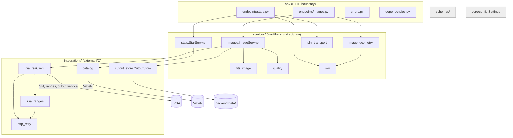
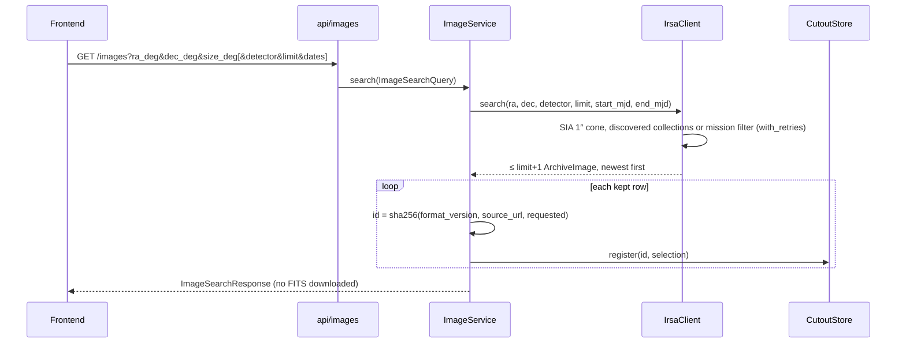
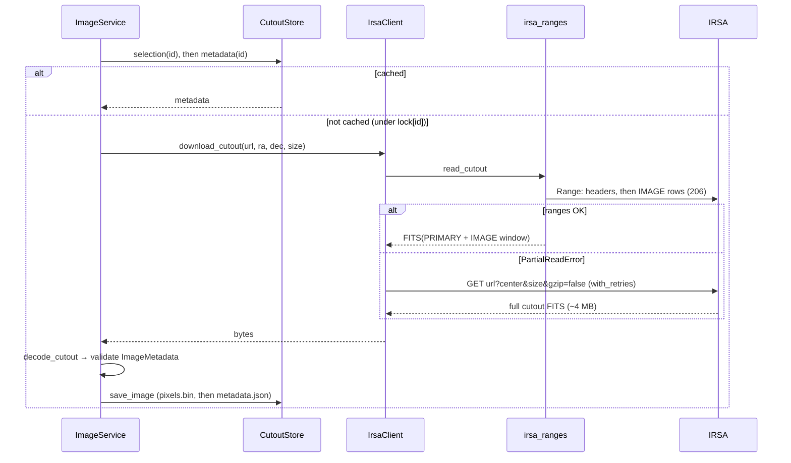

# Astrea backend — Design

- **Phase:** Design (spec-driven development: requirements → **design** → tasks)
- **Scope:** `backend/`, the FastAPI service
- **Baseline:** branch `KC-Rama`, commit `5b74092` ("commit 2.0.1"), plus the
  hardening in [`spec.md`](spec.md), which resolves the findings in §15.
  131 offline tests pass.
- **Date:** 2026-11-14
- **Related:**
  - `docs/superpowers/specs/2026-11-14-spherex-blink-viewer-design.md`: product intent and acceptance targets
  - `docs/superpowers/specs/2026-11-14-astrea-backend-technical-documentation.md`: interpretation guide (written at `ef4f862`; §15 lists what is now outdated)
  - `docs/superpowers/specs/2026-11-14-spherex-backend-fastapi-design.md`: active frontend-owned Blink integration contract
  - `backend/API.md`: the public HTTP contract, which wins if this document disagrees

## 1. Overview

The backend is the only part of Astrea that talks to external archives. It
gives the frontend four capabilities:

1. **Discover** SPHEREx Level 2 spectral images at IRSA that contain a sky
   position.
2. **Load** a cutout of one image: its intensities as raw numbers, and the
   metadata (WCS, footprint, provenance) needed to interpret and place it.
3. **Correct on request**:
   - zodiacal-background subtraction
   - quality masking from `FLAGS`
   - signal-to-noise from `VARIANCE`

   Each extra plane is also available on its own.
4. **Context**: the Hipparcos star catalog, and the directions of stars and
   images for an observer at a given place and time.

The backend never decides how data looks. It sends numbers; contrast,
colour and drawing happen in the frontend.

## 2. Design goals and constraints

| ID | Goal / constraint | How the design meets it |
| --- | --- | --- |
| D1 | **Modular, step-by-step growth**: a new feature must not change existing contracts | Layered packages (§3). Features are new routers, services and schemas. Options default to "off" (§6.3) |
| D2 | **Transfer only what is needed** from IRSA | HTTP byte-range reads of individual planes (§5.4). The 4 MB PSF table is never downloaded |
| D3 | **Raw science values** reach the client unaltered | Little-endian floats in C order. NaN, ±∞ and negative values are preserved. No stretch on the server |
| D4 | **Resilient to brief archive hiccups** | Bounded retries with backoff and `Retry-After` (§5.5). Automatic fallback to the cutout service |
| D5 | **Repeat views need no network** | Disk cache keyed by content-addressed IDs. Atomic writes. Cached data survives restarts (§7) |
| D6 | **Fail with clear, stable errors** | Domain exceptions map to fixed HTTP statuses and messages. Tracebacks stay in the logs (§8) |
| D7 | **Safe outbound I/O** | URL allowlist, no redirects, size and time caps, validated inputs before any network call (§10) |
| D8 | **Testable without network** | Services receive their dependencies. Archive fakes plug in at `app.state` (§12) |

Constraints:
- Single process. One Uvicorn worker is recommended.
- No database and no job queue.
- Python 3 with FastAPI, Pydantic v2, astropy, astroquery, numpy and requests.

**Non-goals for this design:**
- common-grid reprojection (optional future analysis)
- blink selection, playback and display scaling (frontend responsibilities)
- spectra
- photometry
- server-side rendering
- multi-worker shared state
- authentication

## 3. Architecture

### 3.1 Layers



**Dependency rule:** `api → services → integrations`. Schemas and settings may
be imported by every layer. Routes never import `integrations` directly.
Services never import FastAPI types.

### 3.2 Composition

`create_app(settings: Settings | None) -> FastAPI` (in `application.py`):

1. Adds `CORSMiddleware`: `settings.cors_origins`, methods GET and POST, header
   `Content-Type`.
2. Adds `GZipMiddleware` for bodies of at least 1000 bytes.
3. Stores the services on `app.state`:
   - `star_service = StarService(settings.star_cache_path)`
   - `image_service = ImageService(archive=IrsaClient(), store=CutoutStore(settings.cutout_cache_dir), api_prefix=settings.api_prefix, bad_flags=settings.bad_flags)`
4. Calls `register_exception_handlers(app)`.
5. Calls `include_router(api_router, prefix=settings.api_prefix)` (`/api/v1`).

`main.py` exposes `app = create_app()` for `uvicorn app.main:app`. Importing
the module does not contact any external service.

### 3.3 Execution model

All endpoints are synchronous `def` functions, so FastAPI runs them in its
threadpool. The work is blocking HTTP plus CPU-bound numpy/astropy, so
`async` would add complexity without benefit. Requests are independent HTTP
calls, with no WebSockets or streaming sessions.

## 4. Components and interfaces

### 4.1 HTTP layer (`api/`)

| Route (prefix `/api/v1`) | Handler | Service call |
| --- | --- | --- |
| `GET /images` | `search_images(query: ImageSearchQuery)` | `ImageService.search` |
| `POST /images/search` | `search_from_click(ClickSearchRequest)` | `click_to_icrs` → `ImageService.search` |
| `POST /images/search-box` | `search_from_box(BoxSearchRequest)` | `directions_to_icrs` → `box_selection` → `ImageService.search` |
| `GET /images/{id}` | `image_metadata` | `ImageService.metadata` |
| `POST /images/load/{id}` | `load_image` | `ImageService.metadata` |
| `GET /images/{id}/pixels` | `image_pixels(subtract_zodi, mask_flags, signal_to_noise)` | `pixels` (all options off → `FileResponse`) or `corrected_pixels` |
| `GET /images/{id}/planes/{plane}` | `plane_metadata` | `ImageService.plane` |
| `GET /images/{id}/planes/{plane}/pixels` | `plane_pixels` | `ImageService.plane_pixels` → `FileResponse` |
| `POST /images/{id}/projection` | `image_projection(ProjectionRequest)` | `metadata` → `project_image` |
| `GET /stars` | `stars(magnitude_limit)` | `StarService.selected` |
| `GET /star-catalog` | `star_catalog` | `StarService.metadata` |
| `POST /sky` | `sky(SkyRequest)` | `StarService` → `calculate_sky` → `encode_sky` (binary) |
| `GET /targets` | `targets()` | `TargetService.targets` (loaded and propagated once at startup) |

- **Path validation:** `image_id` must match `^[0-9a-f]{64}$`. `plane` must
  be `Literal["flags", "zodi", "variance"]`. Anything else returns 422 before
  any I/O.
- **Dependency injection:** `get_image_service` and `get_star_service` read
  from `request.app.state`. This is the seam for tests and for future
  services.

### 4.2 `ImageService` (`services/images.py`)

```python
class ImageService:
    def __init__(self, archive: IrsaClient, store: CutoutStore, api_prefix: str,
                 bad_flags: tuple[str, ...] = DEFAULT_BAD_FLAGS): ...
    def search(self, query: ImageSearchQuery) -> ImageSearchResponse
    def metadata(self, identifier: str) -> ImageMetadata          # lazy load + cache
    def pixels(self, identifier: str) -> Path                      # raw IMAGE bytes on disk
    def plane(self, identifier: str, plane: str) -> PlaneMetadata  # lazy plane load + cache
    def plane_pixels(self, identifier: str, plane: str) -> Path
    def corrected_pixels(self, identifier: str, *, subtract_zodi=False,
                         mask_flags=False, signal_to_noise=False) -> bytes
```

Responsibilities:
- Build image IDs (§6.1) and register selections when a search runs.
- Download, decode, validate and cache, at most once per ID per process.
  A pool of 32 locks is indexed by `int(id[:8], 16) % 32`.
- Rebuild `metadata_url`, `pixels_url` and the plane `pixels_url` from the
  current `api_prefix` on every read. Routes can then change without
  invalidating the cache.
- Apply the masking policy at read time (`bad_bits(flag_bits, self.bad_flags)`).
  The policy is configuration, so it is never cached.
- Corrected pixels are computed per request from the cached planes and are not
  stored. Each costs milliseconds.

### 4.3 FITS decoding (`services/fits_image.py`)

```python
PLANES = {"flags": ("FLAGS", "int32"), "zodi": ("ZODI", "float32"), "variance": ("VARIANCE", "float32")}
def decode_cutout(content: bytes) -> DecodedImage           # IMAGE + celestial WCS
def decode_plane(content: bytes, plane: str, width: int, height: int) -> DecodedPlane
class InvalidFitsError(ValueError)
```

`decode_cutout`:
- Requires a 2D `IMAGE` HDU of at most 4096² pixels with a celestial WCS.
- float32 stays float32; float64 is never downcast; integers become float64.
- Computes the centre, an outer-edge footprint (LL, LR, UR, UL), finite
  statistics, the WCS cards (SIP included) and provenance (OBSID, DETECTOR,
  VERSION, `DATE*`/`MJD*`).
- `DATE` is kept as metadata and never used as the observation time.

`decode_plane`:
- Checks that the plane shape equals the image's `(height, width)`.
- FLAGS → `<i4` (rejected if values exceed int32); ZODI and VARIANCE → `<f4`.
- Values are not altered.
- Extracts `flag_bits` from the `MSKNnnnn`/`MSKDnnnn` header cards.

### 4.4 Quality (`services/quality.py`), pure functions

```python
DEFAULT_BAD_FLAGS = ("TRANSIENT","OVERFLOW","SUR_ERROR","NONFUNC","MISSING_DATA","HOT","COLD","PERSIST")
NEVER_MASKED = frozenset({"SOURCE"})
def bad_bits(flag_bits: list[dict], names) -> tuple[list[str], int]
def corrected(image, *, zodi=None, variance=None, flags=None, bad_mask: int = 0) -> np.ndarray
```

- Flags are selected by **name**, resolved against each file's own bit
  definitions.
- `SOURCE` is always excluded, because it marks pixels on known stars.
- Order of operations: subtract zodi → divide by `sqrt(variance)` → mask.
  Variance that is not positive or not finite gives NaN. The result keeps the
  image's floating-point type.

### 4.5 Geometry and sky (`services/image_geometry.py`, `sky.py`, `sky_transport.py`)

- `directions_to_icrs(directions, observer, at) -> SkyCoord` converts scene
  directions (+X east, +Y up, −Z north) to ICRS with airless AltAz.
  `click_to_icrs(direction, observer, at) -> (ra, dec)` wraps it for one click.
- `box_selection(corners) -> BoxGeometry(ra_deg, dec_deg, size_deg, corners)`
  gives a dragged box's centre (normalised mean of the corner vectors) and the
  side of the north-aligned tangent-plane square that covers it. Outside
  6.15″ to 0.5° it raises `SelectionTooSmall` / `SelectionTooLarge`.
- `build_mesh(wcs, w, h)` adaptively refines through 8 → 128 segments until
  interpolation error is at most 0.15 native pixel. UVs sit on pixel edges.
- `project_image(metadata, observer, at, live)` returns UVs, indices and
  directions for each time sample.
- `observation_context` produces 1 sample (paused) or 13 (live, 10 s apart over
  120 s). It refuses times outside IERS coverage
  (`EarthOrientationUnavailable`).
- `calculate_sky` propagates proper motion (angles only), then transforms
  ICRS → AltAz with no refraction.
- `encode_sky` builds the `SKY1` packet (§6.4).

### 4.6 `StarService` (`services/stars.py`) and `catalog.py`

- Loads Hipparcos `I/239/hip_main` once: from memory, then the disk cache,
  then VizieR (`vizier.cfa.harvard.edu`, 30 s timeout).
- Rejects any download that does not have exactly 118 218 rows.
- Keeps the native epoch J1991.25 and sorts by (magnitude, HIP).
- `catalog_version = "hipparcos-v1-" + sha256(stars)[:20]`. A stale version
  sent to `/sky` returns 409.

### 4.7 `IrsaClient` (`integrations/irsa.py`)

```python
@dataclass(frozen=True)
class ArchiveImage: source_url; observation_id; detector; collection; observed_start_mjd; observed_end_mjd
class IrsaClient:
    def __init__(self, ranges: RangeReader | None = None, budget_seconds: float = 120.0)
    def search(self, *, ra_deg, dec_deg, detector, limit, start_mjd=None, end_mjd=None) -> list[ArchiveImage]
    def download_cutout(self, source_url, ra_deg, dec_deg, size_deg) -> bytes
    def download_plane(self, source_url, ra_deg, dec_deg, size_deg, extension,
                       grid: tuple[crpix1, crpix2, width, height]) -> bytes
def align_plane(content: bytes, extension: str, grid) -> bytes   # service plane → image grid
class ArchiveError(Exception); class ArchiveTimeout(ArchiveError); class SearchTooBroad(ArchiveError)
```

**Search:**
- `astroquery` `Irsa().query_sia` with a 1″ cone over dynamically discovered
  SPHEREx collections, `maxrec=10000`. `list_collections` uses TAP; names are
  cached per client for one hour. Failed refreshes retain the last list and retry
  after 60 seconds. On initial network/VO failure, SIA uses `facility="SPHEREx"`
  without a release-name restriction and postpones registry retries for 60 seconds.
  Empty/malformed registry tables are errors.
- Astroquery's PyVO SIA service uses `check_baseurl=False` with the known IRSA
  `/SIA` endpoint, avoiding an extra capabilities request whose errors can lose
  HTTP status/cause information before reaching our retry logic.
- A guarded adapter allows only the `/SIA` paths and `/TAP/sync`, `/TAP/capabilities` and adds a `(10, 60)` s
  timeout.
- Retries on transient failures. An overflow, or 10 000 rows or more, raises
  `SearchTooBroad`.
- Rows are filtered locally by detector (from `energy_bandpassname`) and by
  start time.
- Results are deduplicated by URL, sorted by `t_min` descending (URL breaks
  ties), and `limit + 1` rows are returned.

**Downloads:**
- **Primary path:** byte ranges via `irsa_ranges` (§4.8).
- **Fallback:** the IBE cutout service. It is used on `PartialReadError` or on
  an unexpected layout.
- **One time budget per download** (`budget_seconds`, from
  `Settings.archive_budget_seconds`). It covers every ranged request, retry
  wait and the fallback, and running out gives `ArchiveTimeout` → 504.
- **Planes follow the image's grid.** `ImageService` passes the loaded image's
  `(CRPIX1, CRPIX2, width, height)`. `RangeReader.read_plane` reads exactly
  that window. On fallback, `align_plane` cuts or pads the service plane onto
  it: NaN for float planes, the file's `MISSING_DATA` bit for FLAGS. A
  fractional grid offset is an `ArchiveError`.
- Network errors map to `ArchiveTimeout` or `ArchiveError`. They do **not**
  fall back, because the service would hit the same outage.

### 4.8 Byte-range reader (`integrations/irsa_ranges.py`)

```python
class PartialReadError(Exception)
class RangeReader:               # owns requests.Session + LRU of layouts (MAX_LAYOUTS = 256)
    def __init__(self, session=None, max_layouts=MAX_LAYOUTS)
    def open(self, url, deadline=None) -> RemoteExposure
    def read_cutout(self, url, ra, dec, size, deadline=None) -> bytes   # PRIMARY + IMAGE window
    def read_plane(self, url, extension, grid, deadline=None) -> bytes  # one plane, on the image grid
class RemoteExposure:            # per-file layout, discovered lazily
    find(name, deadline=None) -> dict | None
    window(name, x0, y0, w, h, deadline=None) -> np.ndarray
def pixel_window(header, ra_deg, dec_deg, size_deg) -> (x0, y0, w, h)
def grid_origin(header, grid) -> (x0, y0)     # origin = CRPIX_header − CRPIX_grid, integer
```

- **Opening a file:** the first request reads `16 × 2880` bytes (HEADER_GUESS)
  and parses as many headers as that covers. Later extensions are discovered
  on demand.
- **Window:** computed from the IMAGE WCS and the pixel scales on each axis,
  then clipped at the detector edge. All planes of one selection therefore
  share the same window. `CRPIX*` (including alternate WCS) is shifted by the
  window origin.
- **Uncompressed planes** (IMAGE, ZODI, VARIANCE): one byte range per row.
  Ranges less than 256 bytes apart are merged, with at most 96 ranges per
  request.
- **FLAGS** is tile-compressed with one tile per detector row. The reader
  fetches the row index, then the heap slice for the rows needed, and rebuilds
  a small valid compressed HDU to decode.
- **Guards:**
  - A response other than 206 raises `PartialReadError`. The reader never
    accepts a full 60 MB file.
  - Each request has a 90 s deadline and a byte cap.
  - Multipart parts are delimited by their lengths, not by boundary text.
- **Concurrency:** each `RangeReader` has an `RLock` protecting its layout
  registry. Each exposure has its own `RLock`, so different files can be read
  in parallel. Each app instance gets its own reader through its
  `IrsaClient`.

### 4.9 Retry policy (`integrations/http_retry.py`)

```python
RETRY_STATUS = {429, 500, 502, 503, 504}; RETRY_DELAYS = (1.0, 2.5); MAX_RETRY_AFTER = 5.0
def is_transient(error) -> bool
def with_retries(action, *, transient=is_transient, sleep=None, deadline=None)
def timeout_until(deadline, connect=10.0, read=40.0) -> (connect, read)   # Timeout once the deadline passed
```

No retry wait starts if it would end after `deadline`. Every request's
timeouts shrink to the remaining budget.

- **Retried:** connection errors, `ChunkedEncodingError`, and HTTP errors with
  a status in `RETRY_STATUS`.
- **Not retried:** timeouts, because the wait would triple.
- At most 3 attempts. The delay honours `Retry-After`, clamped between the
  default delay and 5 s.

### 4.10 `CutoutStore` (`integrations/cutout_store.py`)

```python
register(id, selection) / selection(id) -> dict
metadata(id) -> dict | None ; pixels_path(id) ; save_image(id, metadata, pixels)
plane_metadata(id, plane) -> dict | None ; plane_path(id, plane) ; save_plane(id, plane, metadata, pixels)
class UnknownImageError(Exception); class CacheError(Exception)
```

- Atomic writes: a temporary file in the same directory, then `os.replace`.
- A JSON description is written **after** its binary, so it acts as the
  completion marker. Unreadable JSON is treated as missing, which causes a
  re-download.

## 5. Key flows

### 5.1 Search



### 5.2 Load an image



### 5.3 Corrected pixels

1. `metadata(id)` makes sure IMAGE is cached.
2. For each requested option, `plane(id, name)` makes sure that plane is
   cached. It uses the same lock and calls `download_plane` with the image grid,
   which reads by ranges over exactly that window.
3. The cached `.bin` files are loaded with `np.fromfile` and passed to
   `quality.corrected`.
4. The bytes are returned with the same dtype and layout as the raw pixels.

A ten-arcminute cutout costs about 85 kB / ~2 s for IMAGE, 40–130 kB for
ZODI or VARIANCE, and about 500 kB for FLAGS on first use. Later requests
take milliseconds. These are the measurements in `API.md` from 2026-11-14.

### 5.4 Why byte ranges

The IBE cutout service always returns all six extensions, including the 4 MB
`EPSF` table: about 4.1 MB and 6–10 s for 10′. Level 2 files are plain FITS
on a server that honours `Range`, so reading the headers and then only the
needed rows gives pixel values identical to the service's at about 2 % of the
bytes. The service stays as the fallback, so correctness never depends on
the optimisation.

## 6. Data models

### 6.1 Identifiers

```text
image_id = sha256(json.dumps({"format_version": 1,
                              "source_url": <archive URL>,
                              "requested": {"ra_deg", "dec_deg", "size_deg", "frame": "ICRS"}},
                             sort_keys=True)).hexdigest()
```

- An image ID identifies one cutout geometry of one file. It is not an
  exposure ID: a different centre or size gives a different ID.
- `format_version` is the cache version. Bumping it invalidates every ID.

### 6.2 Schemas (`schemas/images.py`, `schemas/sky.py`)

| Model | Key fields |
| --- | --- |
| `ImageSearchQuery` | `ra_deg [0,360)`, `dec_deg [−90,90]`, `size_deg (0,0.5]`, `detector 1–6?`, `limit 1–100 (20)`, `start_time?`/`end_time?` (timezone required, start ≤ end). `extra="forbid"`, no NaN/∞ |
| `ImageSummary` | `id`, `observation_id`, `detector`, `collection` (open release identifier), `observation` (MJD + UTC), `requested`, `source_url`, `metadata_url`, `pixels_url` |
| `ImageSearchResponse` | `query`, `images[]`, `has_more`, `order="observation_start_desc"` |
| `ImageMetadata` | `ImageSummary` + `image: ImageDataMetadata` |
| `ImageDataMetadata` | `width`, `height`, `dtype` (f32\|f64), `byte_order="little"`, `array_order="C"`, `pixel_origin="lower-left"`, `unit`, `finite_min/max`, `nonfinite_count`, `center`, `footprint`, `wcs_header[]`, `fits_metadata` |
| `PlaneMetadata` | `image_id`, `plane`, `extension`, `width`, `height`, `dtype` (i32\|f32), layout fields, `unit`, `flag_bits[]`, `masked_flags[]`, `masked_bits`, `pixels_url` |
| `FlagBit` | `bit`, `name`, `description` |
| `Observer` | `latitude_deg`, `longitude_deg`, `elevation_m [−500, 10000]` |
| `ProjectionRequest` | `observer`, `at` (aware), `mode` (`live`\|`paused`) |
| `SkyRequest` | + `magnitude_limit [−2,15]`, `format` (`json`\|`binary`), `catalog_version?` |
| `ClickSearchRequest` | + `direction[3]`, `size_arcmin (0,30] = 6`, `detector?`, `limit`, dates |
| `BoxSearchRequest` | + `corners[4][3]` (nonzero, components in −1…1), `detector?`, `limit`, dates |
| `BoxSearchResponse` | `ImageSearchResponse` + `selection {center, size_deg, corners[4]}` |

### 6.3 Wire formats

| Payload | Encoding |
| --- | --- |
| Image pixels | `application/octet-stream`; `width × height` float32 or float64, little-endian, C order, row 0 = bottom FITS row; NaN/∞ preserved |
| Corrected pixels | Same layout as raw pixels; rejected or undefined samples are NaN |
| Plane pixels | Same grid as the image; FLAGS `<i4` bitmask, ZODI/VARIANCE `<f4` |
| Projection | JSON: `uv`, `indices`, `sample_times_ms`, `directions[T][3V]`, `center_directions` |
| Sky (`SKY1`) | `"SKY1"` + uint32 LE header length + JSON header padded to 4 bytes + float32 LE directions (sample × star × xyz) |

**Contract rule:** pixel options default to `false`, so a call without options
always returns the untouched IMAGE plane. Statistics in `ImageDataMetadata`
describe the raw plane only.

## 7. Storage design

| Path (under `backend/data/`) | Content | Written when | Lifetime |
| --- | --- | --- | --- |
| `hipparcos-v1.json` | Parsed catalog + identity fields | First catalog load | Until the identity changes |
| `image-cutouts/{id}.selection.json` | Archive row + requested geometry | Search | Until deleted |
| `image-cutouts/{id}.pixels.bin` + `.metadata.json` | Raw IMAGE + validated metadata | First load | Immutable |
| `image-cutouts/{id}.{flags,zodi,variance}.bin` + `.json` | Plane values + description | First use of that plane | Immutable |

Process memory holds:
- the star catalog and its metadata;
- up to 256 `RemoteExposure` layouts (headers + leftover bytes), evicted LRU.

There is no quota and no eviction on disk. Both directories are git-ignored.
Full FITS files are never persisted.

## 8. Error handling

| Exception (raised in) | HTTP | Public `detail` |
| --- | --- | --- |
| Pydantic validation (api) | 422 | FastAPI's structured list |
| `SearchTooBroad` (irsa) | 422 | Too many archive matches. Narrow start_time/end_time and retry. |
| `EarthOrientationUnavailable` (sky) | 422 | Time outside Earth-orientation data… |
| `HTTPException` (stars route) | 409 / 422 | Stale catalog version / no stars at limit |
| `UnknownImageError` (store) | 404 | Unknown image. Run an image search first. |
| `ArchiveError` (irsa) | 502 | IRSA data could not be retrieved. Please retry. |
| `InvalidFitsError` (fits_image) | 502 | IRSA returned an unsupported or invalid FITS image. |
| `MeshError` (image_geometry) | 422 | This image's WCS cannot be projected accurately. Try a smaller size. |
| `SelectionTooLarge` / `SelectionTooSmall` (image_geometry) | 422 | The exception's own message, stating the selected size and the limit |
| `CatalogError` (catalog) | 502 | The star catalog could not be retrieved. |
| `CacheError` (store/service) | 503 | The local image cache is unavailable. |
| `ArchiveTimeout` (irsa) | 504 | IRSA timed out. Please retry. |

- **Resolution:** the handler walks the exception's MRO, so the most specific
  class wins (`ArchiveTimeout` → 504, not 502).
- **Logging:** 5xx errors log the request path and the traceback. The body
  holds only the fixed message.
- **Internal:** `PartialReadError` never reaches HTTP; it triggers the
  fallback.
- **Client guidance:** a 502 means IRSA stayed unavailable through the retries,
  so offer a manual retry rather than looping.

## 9. Concurrency and performance

- **Same image:** a 32-lock pool stops duplicate downloads of one ID in a
  worker. Separate workers could duplicate downloads, but atomic publication
  keeps the result consistent.
- **Byte-range layer:** a per-exposure `RLock` serialises reads of one file.
  Different files are read in parallel. The registry lock is held only to look
  up or insert entries, never during network I/O.
- **Cost model:** the response size is `width × height × 4` bytes (about
  39 kB for 10′), whatever the options. Upstream cost is per plane, and only on
  first use.
- **Timeouts:**
  - SIA: 10 s connect, 60 s read.
  - Ranged GET and cutout service: 10/40 s, plus a 90 s deadline per request.
  - One budget per download (image or plane), 120 s by default, covering
    every request, retry and fallback. Running out gives 504.

## 10. Security

- **Outbound allowlist:**
  - `access_url` must match
    `https://irsa.ipac.caltech.edu/ibe/data/spherex/<release>/level2/…\.fits`
    with no query string and no dot segments.
  - Discovery traffic may only reach `/SIA` paths and `/TAP/sync`, `/TAP/capabilities`.
  - Redirects are refused everywhere.
- **Resource caps:**
  - 80 MiB per cutout download, and a byte cap per ranged request.
  - Images up to 4096² pixels, checked before the data is allocated.
  - At most 10 000 SIA rows.
- **Input validation** happens before any I/O: finite numbers, ranges, a
  timezone on dates, the ID pattern, and a literal plane name.
- **CORS:** only the Vite dev origins are allowed, with GET and POST.
- **Secrets:** none. All upstream services are public. Logs contain only
  public archive URLs.

## 11. Configuration

`core/config.Settings` is a frozen dataclass. `create_app()` uses
`Settings.from_env()`: defaults overridden by `ASTREA_CACHE_DIR`,
`ASTREA_STAR_CACHE`, `ASTREA_TARGETS_FILE`, `ASTREA_CORS_ORIGINS`, `ASTREA_BAD_FLAGS` and
`ASTREA_ARCHIVE_BUDGET_SECONDS`. Invalid values, `SOURCE` in the flag list and
unknown `ASTREA_*` names stop startup. `create_app(Settings(...))` overrides
everything in tests.

| Field | Default |
| --- | --- |
| `app_name` / `app_version` | `Astrea API` / `0.1.0` |
| `api_prefix` | `/api/v1` |
| `cutout_cache_dir` | `backend/data/image-cutouts` |
| `star_cache_path` | `backend/data/hipparcos-v1.json` |
| `targets_path` | `backend/targets.yaml` |
| `cors_origins` | `http://localhost:5173`, `http://127.0.0.1:5173` |
| `bad_flags` | `DEFAULT_BAD_FLAGS` (defined in `core/config.py`) |
| `archive_budget_seconds` | `120.0` |

Some tuning still lives as module constants:
- `irsa.py`: `MAX_SEARCH_ROWS`, `MAX_DOWNLOAD_BYTES`, `DOWNLOAD_SECONDS`
- `irsa_ranges.py`: `HEADER_GUESS`, `MAX_RANGES`, `MERGE_GAP`,
  `REQUEST_SECONDS`, `MAX_LAYOUTS`
- `http_retry.py`: `RETRY_DELAYS`
- `sky.py`: sample interval and live window

Each image or plane download logs one `INFO` line from `IrsaClient`
(`operation`, `image`, `path=ranges|service`, `outcome`, `bytes`, `seconds`,
`retries`); `app/main.py` attaches a handler to the `app` logger.

## 12. Testing strategy

| Level | Files | Approach |
| --- | --- | --- |
| Unit, pure | `test_fits_image.py`, quality cases in `test_planes_api.py` | Synthetic FITS in memory: WCS with rotation and SIP, NaN/∞, dtype rules, invalid inputs |
| Integration contract | `test_irsa.py`, `test_irsa_ranges.py` | `unittest.mock` for astroquery and `requests`. Range and multipart parsing, compressed FLAGS, fallback triggers, retry and timeout mapping, URL allowlist |
| API | `test_images_api.py`, `test_planes_api.py` | `create_app(Settings(tmp_path))` + a `FakeArchive` swapped on `app.state.image_service.archive`, called through `httpx.ASGITransport`. Checks status mapping, single download per ID, restart survival, plane grid equality, option combinations |
| Sky | `test_sky.py` | Hipparcos parsing, cache restart, click round trip, JSON and SKY1 consistency |

Run with `python -m pytest tests -q` from `backend/`. No test uses the
network. Live IRSA behaviour is covered by the measurements in `API.md`, not
by CI.

Every new module adds:
- a pure unit test for its science functions;
- an API test with a fake integration;
- a failure-mapping test.

## 13. Design decisions

| # | Decision | Alternatives considered | Rationale |
| --- | --- | --- | --- |
| DD1 | Layered packages with injection through `app.state` | Flat modules; global singletons | Features grow independently. Tests swap fakes without patching imports |
| DD2 | Raw float pixels; rendering in the frontend | Server-side PNG with stretch | Keeps science values intact. Supports frontend blink; pixel subtraction additionally requires aligned grids. The team's choice |
| DD3 | Byte-range reads per plane, cutout service as fallback | Cutout service only | ~50× fewer bytes and ~3× faster. The fallback preserves correctness |
| DD4 | Planes fetched on demand, not with the image | Fetch all planes at load | FLAGS is the most expensive plane. Most views never need it |
| DD5 | Corrections as optional query flags (default off) plus raw plane endpoints | A separate endpoint per correction; always corrected | Backward compatible. The simple path needs no client maths, and the plane path allows instant toggles |
| DD6 | Mask flags by name; `SOURCE` never masked | Fixed bit numbers | Bit assignments belong to each file. `SOURCE` marks stars |
| DD7 | Content-addressed IDs with `format_version` | Database IDs; archive `obs_id` | Stateless and reproducible. One `obs_id` covers six arrays |
| DD8 | Retry only short transient failures, never timeouts | Retry everything; no retries | Busy-server blips clear in seconds. Retrying a timeout triples the wait |
| DD9 | Disk cache with JSON completion markers | In-memory cache; SQLite | Survives restarts. Crash-safe without extra dependencies |
| DD10 | Synchronous endpoints | `async def` with async HTTP | The work is blocking or CPU-bound. Simpler, and the threadpool is enough |

## 14. Extension points (next modules)

New modules follow the recipe in the technical documentation, §13: schema →
integration (if any) → service → wiring in `create_app` and `dependencies.py`
→ router → error mapping → tests → `API.md`.

| Module | Reuses | New pieces |
| --- | --- | --- |
| Frontend blink integration | Existing image search, load, pixels and per-image WCS projection | No new backend module or routes. Frontend owns A/B selection, shared display scale and playback; future sequences can include more observations |
| Common-grid analysis (optional later) | Image data, WCS and optional corrections | Separately specified resampling for subtraction/measurements; not a prerequisite for visual blink |
| Pre-warm CLI — *implemented* | `ImageService` and existing cache | `targets.yaml` + `services/targets.py` (proper motion, `GET /targets`), `app/warm.py` (time-spread choice, manifest, `--offline` cache check). Browser offline discovery still needs a separate handoff |
| Spectra | `irsa_ranges` (`WCS-WAVE` plane) | Wavelength at the target |
| Overlays | `catalog.py` pattern | Gaia DR3 / WISE |

## 15. Review of `5b74092` (findings, all resolved by [`spec.md`](spec.md))

Strengths:
- Clean additions with no contract breaks.
- Byte-range reading with a safe fallback.
- The masking policy is not cached.
- Thorough offline tests (117 passing).

| ID | Finding | Impact | Resolution |
| --- | --- | --- | --- |
| R1 | If the **range read of a plane** fails (`PartialReadError`) after IMAGE was loaded by ranges, the fallback service cutout can differ by one pixel along an edge. `decode_plane` then raises `InvalidFitsError` (502). The result isn't cached, so each retry downloads about 4 MB again | That plane stays unavailable for this image | **Resolved** (REQ-1): planes are read on the image grid; `align_plane` crops or pads service planes |
| R2 | No overall time budget per HTTP request. Several ranged GETs, each with a 90 s deadline and up to 3 attempts, can add up to minutes | Long hangs in the browser | **Resolved** (REQ-2): `archive_budget_seconds` deadline through every request, retry and fallback |
| R3 | `core/config.py` imports `services.quality.DEFAULT_BAD_FLAGS` | Inverts the dependency rule (core → services) | **Resolved** (REQ-3): `DEFAULT_BAD_FLAGS` lives in `core/config.py` |
| R4 | `irsa_ranges` keeps a module-level `requests.Session` and layout registry | Harder to inject in tests; state is shared across app instances | **Resolved** (REQ-4): `RangeReader` instance owned by `IrsaClient` |
| R5 | Unmapped `ValueError` from `build_mesh` returns 500 | Error message isn't clear | **Resolved** (REQ-5): `MeshError` → 422 |
| R6 | The technical documentation (written at `ef4f862`) says "no retries", "raw IMAGE only" and "cutout service only" | Misleads readers | **Resolved** (REQ-6): technical documentation, `API.md`, `environment.md` updated |
| R7 | `requirements.txt` has no versions; torch/transformers are unused by the API | Slow, non-reproducible installs | **Resolved** (REQ-7): `requirements.txt` (API + tests, minimum versions) and `requirements-notebooks.txt` |

## 16. Requirements traceability

Requirements live in [`requirements.md`](requirements.md) (SRCH, DATA, GEO,
BLNK, OFF, NFR and AT IDs, with goal traceability in its §5). This design
covers them as follows:

| Requirements | Design sections |
| --- | --- |
| SRCH-1, SRCH-5–9 | §4.7 (`IrsaClient.search`, release discovery), §5.1 |
| SRCH-2, SRCH-3, SRCH-4 | §4.1 (routes), §4.5 (`directions_to_icrs`, `box_selection`) |
| DATA-1–3, DATA-7–8 | §4.2, §4.3, §6.3 |
| DATA-4–6 | §4.4 (`quality`), §4.7 (`download_plane`, `align_plane`), §5.3 |
| GEO-1–4 | §4.5 |
| BLNK-1–5 | §4.2 (IDs, cache, locks), §14 (frontend blink integration); `API.md` blink checklist |
| OFF-1–4 | §14 (pre-warm CLI, optional) |
| NFR-1–12 | §2 (D1–D8), §7–§12 |

Historical PNG rendering, server-side frame selection and mandatory
reprojection are not requirements (requirements §4).
