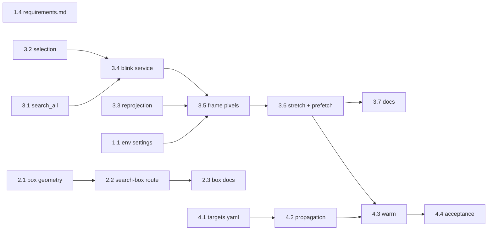

# Astrea backend — Tasks

- **Phase:** Tasks (spec-driven development: requirements → design → **tasks**)
- **Scope:** `backend/`
- **Inputs:**
  - [`design.md`](design.md): architecture, components, and decisions DD1–DD10
  - [`spec.md`](spec.md): hardening REQ-1 to REQ-7 (done)
  - Blink design: [`../../superpowers/specs/2026-11-14-spherex-backend-fastapi-design.md`](../../superpowers/specs/2026-11-14-spherex-backend-fastapi-design.md)
  - Product goals G1–G7 and acceptance targets: [`../../superpowers/specs/2026-11-14-spherex-blink-viewer-design.md`](../../superpowers/specs/2026-11-14-spherex-blink-viewer-design.md)
- **Baseline:** `KC-Rama` at `5b74092` plus the `spec.md` hardening (131 tests passing).

## How to use this file

- Work **top to bottom**. Phases 1–4 are the demo path. Phase 5 is later.
- Each task is one reviewable change (one PR or commit).
- Each task follows the module recipe in
  `2026-11-14-astrea-backend-technical-documentation.md` §13:

  ```
  schema → integration → service → wiring → route → errors → tests → API.md
  ```
- A task is **done** when:
  - its *Done when* items hold;
  - `python -m pytest tests -q` passes;
  - `API.md` and `design.md` match the code.
- Rules for every task:
  - Never change an existing response shape. Only add routes, or optional
    fields and parameters with defaults (D1).
  - No test may use the network. Live checks are manual and listed explicitly.
- Status markers: `[ ]` to do, `[~]` in progress, `[x]` done.

## Phase 0 — Done

- [x] **0.1** Image search, load, raw pixels, projection, stars and sky (`ef4f862`).
- [x] **0.2** Byte-range downloads, retries, extra planes, on-request corrections (`5b74092`).
- [x] **0.3** Hardening R1–R7: grid-aligned planes, download budget, layering,
  `RangeReader`, `MeshError` → 422, docs, split requirements ([`spec.md`](spec.md) T1–T8).

## Phase 1 — Foundations

### [ ] 1.1 Settings from environment variables

- **Why:** deployment and demo machines need different cache paths, CORS
  origins and budgets without code edits (design §11).
- **Changes:**
  - `core/config.py`: add `Settings.from_env(environ=os.environ) -> Settings`.
    It reads `ASTREA_CACHE_DIR`, `ASTREA_STAR_CACHE`, `ASTREA_CORS_ORIGINS`
    (comma-separated), `ASTREA_BAD_FLAGS` and `ASTREA_ARCHIVE_BUDGET_SECONDS`.
    Unknown or invalid values raise at startup.
  - `application.py`: `create_app(settings=None)` uses `Settings.from_env()`
    when no settings are passed.
  - Reject `SOURCE` in `bad_flags` at startup. Today it is only skipped
    silently.
- **Done when:**
  - Every field can be overridden by environment variable.
  - Defaults are unchanged.
  - A bad value fails fast with a clear message.
- **Tests:** `tests/test_config.py`: defaults, each override, bad number, `SOURCE` rejected.
- **Refs:** D1, D8; roadmap step 2.

### [ ] 1.2 Request timing logs

- **Why:** to see where time goes (search, ranges, fallback, decode,
  projection) before optimising (roadmap step 8).
- **Changes:**
  - Log one `INFO` line per archive operation:
    - `operation`, `image_id`
    - `bytes`, `seconds`
    - `path=ranges|service`, `retries`
  - Emit the line from `IrsaClient`; `ImageService` adds `image_id`.
  - Logs carry no secrets and only public URLs.
- **Done when:** one line per image or plane download, and a warning when the
  fallback was used.
- **Tests:** assert with `caplog` in `test_irsa_ranges.py` and `test_planes_api.py`.
- **Refs:** D6.

### [ ] 1.3 Check the minimum dependency versions

- **Why:** the `>=` bounds in `requirements.txt` resolve, but the tests only
  ran on the newest releases (spec REQ-7).
- **Changes:**
  - Add `requirements-min.txt` with `==` at each lower bound.
  - Add a short "verify minimum versions" section to `environment.md`.
  - Raise any bound that fails.
- **Done when:** the suite passes on both the minimum and the latest sets.
  Record the result in `environment.md`.
- **Refs:** REQ-7.

### [ ] 1.4 Product requirements document

- **Why:** `design.md` §16 traces to product goals because `requirements.md`
  does not exist yet.
- **Changes:** write `docs/sdd/backend/requirements.md` with EARS
  requirements for:
  - G1–G7 from the product spec;
  - the acceptance targets;
  - the non-functional goals D2–D7.

  Then update the traceability table in `design.md` §16.
- **Done when:** every task in Phases 2–3 names at least one requirement ID.

## Phase 2 — Box selection on the sky map (image search)

The user drags a rectangle on the 3D sky instead of clicking a single point.
The backend turns the rectangle into an ICRS centre and a cutout size, then
runs the existing image search. The geometry stays in the backend, so
coordinates have a single source of truth (same rule as the click search,
`POST /images/search`).

**Behaviour:**

- **Input:** the four corner directions of the dragged rectangle, in the
  scene frame (+X east, +Y up, −Z north), plus the same `observer`, `at`,
  `mode` and filters (`detector`, `limit`, `start_time`, `end_time`) as the
  click search.
- **Centre:** the normalised mean of the four corners' ICRS unit vectors.
- **Size:** the side of the north-aligned square that encloses the box in the
  tangent plane at the centre: `size_deg = 2 · max(|Δlon|, |Δlat|)` over the
  corners. A box rotated relative to north therefore gets a larger square
  that still covers all of it.
- **Limits:** the result must satisfy the existing `size_deg` rule
  (`0 < size ≤ 0.5°`):
  - A larger box returns 422 with the selected size and the maximum.
  - A box smaller than one SPHEREx pixel (6.15″) returns 422 asking the user
    to drag a larger box or click instead.
- **Search semantics:** unchanged. The search finds exposures that contain
  the box **centre**. Each cutout is the square above, so near an
  exposure edge the cutout may be clipped (`width`/`height` in the metadata
  are authoritative). Exposures that touch the box but not its centre are
  out of scope (task 5.7).

### [ ] 2.1 Shared sky-direction geometry

- **Changes:** `services/image_geometry.py`:
  - `directions_to_icrs(directions, observer, at) -> SkyCoord`: a vectorised
    form of today's `click_to_icrs` logic. It validates that each vector is
    finite and non-zero, then converts AltAz → ICRS. `click_to_icrs` becomes
    a one-line wrapper with unchanged behaviour.
  - `box_selection(corners: SkyCoord) -> BoxGeometry(center, size_deg, corners)`,
    a pure function:
    - centre as above;
    - offsets via `center.skyoffset_frame()`;
    - `SelectionTooLarge` / `SelectionTooSmall` (both `ValueError`
      subclasses) when the size is outside the limits.
- **Done when:**
  - The click search behaves identically (existing tests unchanged).
  - `box_selection` handles the RA 0°/360° wrap, Dec ±89.9° and boxes
    rotated 45°.
- **Tests:** `tests/test_sky.py` (or a new `tests/test_box_selection.py`):
  - **Round trip:** build four ICRS corners around a known centre, turn them
    into scene directions with `calculate_sky`, recover the centre within 1″
    and the size within 1 %.
  - **Edge cases:** an RA wrap box centred at 359.99°, a box near the pole,
    and a 45°-rotated box (size = side × √2).
  - **Limits:** too large → `SelectionTooLarge`; corners closer than 6.15″
    → `SelectionTooSmall`; zero or non-finite vectors are rejected.
- **Refs:** G1, G7; D3, D6, D8.

### [ ] 2.2 Box search schema, route and errors

- **Changes:**
  - `schemas/sky.py`: `BoxSearchRequest(ProjectionRequest)`:
    - `corners`: exactly four `direction` vectors, each component in [−1, 1];
    - `detector?`, `limit`, `start_time?`, `end_time?`, with the same rules
      as `ClickSearchRequest`;
    - `extra="forbid"`, no NaN/∞.
  - `schemas/images.py`:
    - `BoxSelection {center: SkyPosition, size_deg, corners: list[SkyPosition]}`;
    - `BoxSearchResponse(ImageSearchResponse)` adds `selection: BoxSelection`.
      The existing response models are unchanged.
  - `api/v1/endpoints/images.py`: `POST /api/v1/images/search-box`. It runs
    `directions_to_icrs`, then `box_selection`, then
    `ImageService.search(ImageSearchQuery(ra_deg, dec_deg, size_deg, …))`,
    and returns the result with `selection`.
  - `api/errors.py`:
    - `SelectionTooLarge` → 422: "The selected box spans N′; the maximum is
      30′. Zoom in or drag a smaller box."
    - `SelectionTooSmall` → 422: "The selected box is smaller than one pixel.
      Drag a larger box or click instead."
    - IERS errors keep their existing 422.
- **Done when:**
  - Searching by box returns the same `images` as `GET /images` with the
    computed centre and size.
  - IDs match, because they are built from the same `requested` geometry.
  - No FITS is downloaded during the search.
- **Tests:** `tests/test_images_api.py`, using the `FakeArchive`:
  - The archive receives the computed centre (±1e-6°) and `size_deg`.
  - `selection` is echoed back in the response.
  - Loading a returned ID works exactly as for click results.
  - Too large / too small → 422 with the messages above, and the archive is
    never contacted.
  - Malformed `corners` (3 or 5 vectors, a zero vector, NaN) → 422.
  - OpenAPI lists the new route.
- **Refs:** G1, G7; D1, D6.

### [ ] 2.3 Box selection documentation and frontend contract

- **Changes:**
  - `API.md`: add a section "Box selection on the sky" with the request,
    the response, the limits and the search semantics.
  - Describe the frontend side:
    1. On drag end, compute the four screen-corner rays with
       `skyDirectionAtPointer`.
    2. Rotate each by `camera.quaternion`, exactly as for the click.
    3. Reject the box if any corner falls off the sky disc.
    4. Send the corners in drag order.
    5. Draw the returned `selection.corners`.
    6. Load results exactly as for a click.
  - `design.md` §4.1 (route table), §4.5 (geometry) and §6.2 (schemas).
  - Technical documentation §4.2 (a new "search by box" flow) and §14.
- **Done when:** the frontend team can implement box selection from `API.md`
  alone.
- **Refs:** D1.

## Phase 3 — Blink (demo path, roadmap step 4)

Design: Blink spec §3–§6. All frames reuse the existing image pipeline. A
blink frame is an image cutout plus `subtract_zodi` and `mask_flags`,
resampled onto a shared grid.

### [ ] 3.1 Full search without a limit

- **Changes:**
  - `IrsaClient.search_all(*, ra_deg, dec_deg, detector=None, start_mjd=None, end_mjd=None) -> list[ArchiveImage]`
    shares the query code with `search`, returns every row up to
    `MAX_SEARCH_ROWS`, and sorts them ascending by `t_min`.
  - `ArchiveImage` gains `band_min_um` and `band_max_um` (SIA `em_min`/`em_max` × 1e6).
    Both default to `None`, so `search` callers are unaffected.
- **Done when:** `search` behaves exactly as before, and `search_all` returns
  every row, deduplicated by URL.
- **Tests:** `test_irsa.py`: no limit applied, ascending order, metres → µm,
  `SearchTooBroad` at the cap.
- **Refs:** G1; Blink spec §3.1.

### [ ] 3.2 Frame selection (pure)

- **Changes:** `services/frame_selection.py`:
  - `detector_counts(rows) -> dict[int, int]`
  - `choose_detector(counts, requested=None) -> int`: most frames; ties go
    to the higher number.
  - `spread(rows, max_frames) -> list`: evenly spaced target times, nearest
    unused frame for each; keeps the first and last.
- **Done when:** the selection never returns "newest N", keeps the full
  baseline, and is deterministic.
- **Tests:** `tests/test_frame_selection.py`: clustered nights, ties, fewer
  rows than `max_frames`, a requested detector with no rows.
- **Refs:** G2; Blink spec §5.2.

### [ ] 3.3 Reprojection onto a common grid (pure)

- **Changes:**
  - Add `reproject>=0.13` to `requirements.txt`.
  - `services/reprojection.py`:
    - `target_wcs(ra, dec, size_deg, scale_arcsec=6.15) -> (WCS, (n, n))`:
      TAN projection, north up, east left.
    - `to_grid(values, wcs_header, target) -> (array, coverage)`: uses
      `reproject_interp(order="bilinear")`; pixels outside the footprint
      become NaN.
- **Done when:** a point source lands on the same grid pixel (±0.5) from frames
  with different rotation and pixel scale.
- **Tests:** `tests/test_reprojection.py`:
  - frames rotated by 0° and 30°, and at 5.8″ and 6.15″ pixels;
  - outside the footprint → NaN;
  - 0.2° → 118×118.
- **Refs:** G2; Blink spec §5.6.

### [ ] 3.4 Blink schemas and service

- **Changes:**
  - `schemas/blink.py`: `BlinkQuery`, `BlinkFrame`, `BlinkGrid`,
    `SuggestedStretch`, `BlinkResponse` (Blink spec §4.1). Models use
    `extra="forbid"` and reject NaN/∞.
  - `services/blink.py`: `BlinkService(images: ImageService, store, settings)`.
    `query(BlinkQuery) -> BlinkResponse` works in this order:
    1. `search_all`
    2. `choose_detector` and `spread`
    3. register each frame as a normal image (same IDs as `/images`), at
       `fetch_size = clamp(fov, 0.2, 0.5)`
    4. register a blink frame ID: `sha256(format_version, image_id, grid, bad_flags, zodi)`
  - `query` downloads nothing.
- **Done when:**
  - Frames are sorted ascending.
  - `detectors` counts are present.
  - Empty and single-frame results return 200 with a warning.
- **Tests:** `tests/test_blink_api.py`, using a fake archive (pattern from `test_images_api.py`).
- **Refs:** G1, G2; Blink spec §4.1, §5.

### [ ] 3.5 Blink frame pixels

- **Changes:**
  - Add `blink_cache_dir` to `Settings`, default `backend/data/blink/`, and
    git-ignore it.
  - Routes:
    - `GET /api/v1/blink/frames/{id}/pixels`: float32, row 0 = south.
    - `GET /api/v1/blink/frames/{id}`: frame metadata (Blink spec §4.3).
  - Cold path:
    1. `ImageService.corrected_pixels(subtract_zodi=True, mask_flags=True)`
    2. `to_grid`
    3. save pixels first, then metadata, atomically, under a lock per frame ID
  - Response header `X-Astrea-Coverage`.
- **Done when:**
  - Payload length is `n·n·4`.
  - The second request makes no archive call.
  - Unknown ID → 404; upstream errors map as in design §8.
- **Tests:** in `test_blink_api.py`: round trip, cache hit, 404, 502/504 mapping, masked pixels are NaN.
- **Refs:** G2, G3; D3, D5.

### [ ] 3.6 Suggested stretch and prefetch

- **Changes:**
  - Once the reference frame (median epoch) is cached, `BlinkResponse.suggested_stretch`
    holds the 1st/99.5th percentiles of its central `fov` box.
  - Before then it is `null`.
  - After the response, `BackgroundTasks` prefetches uncached frames, at most
    3 at a time, best effort.
- **Done when:**
  - A second `/blink` call after one frame load returns the stretch.
  - Prefetch never downloads the same frame twice. It reuses the
    `ImageService` locks.
- **Tests:**
  - `suggested_stretch` is null before the reference frame is cached, then set.
  - Shared stretch: a source 2× brighter in frame B has larger values than in A.
  - Prefetch runs the fetcher once per frame.
- **Refs:** G2; Blink spec §4.1.

### [ ] 3.7 Blink documentation

- **Changes:**
  - Add a "Blink" section to `API.md`.
  - Update the Blink spec §3.1: `decode_cutout_planes` is replaced by the
    existing plane endpoints, and FLAGS/ZODI caching is now done.
  - Mark roadmap step 4 done in the technical documentation, and add the
    module to `design.md` §4 and §14.
- **Done when:** the frontend team can implement blink from `API.md` alone.

## Phase 4 — Pre-warm and acceptance (roadmap step 5)

### [ ] 4.1 Acceptance targets

- **Changes:**
  - `backend/targets.yaml`: the five targets with ICRS J2000 position, proper
    motion (mas/yr), `expected` and an optional `detector`.
  - **Manual check:** take every value from SIMBAD (or Sesame) and record the
    date in the file. Do not keep the approximate values from the Blink spec.
- **Done when:** each value has a source noted in a YAML comment.
- **Refs:** G4, G5.

### [ ] 4.2 Target propagation and route

- **Changes:**
  - Add `pyyaml` to `requirements.txt`.
  - `services/targets.py`: load and validate the YAML, then propagate with
    `SkyCoord.apply_space_motion` (angles only) to the configured epoch
    (default 2025.6).
  - Route `GET /api/v1/blink/targets` → `Target[]`.
- **Done when:** Barnard's Star moves about 4.4′ between J2000 and 2025.6.
- **Tests:** `tests/test_targets.py`.
- **Refs:** G4.

### [ ] 4.3 Warm command

- **Changes:**
  - `app/warm.py`: `python -m app.warm targets.yaml [--only NAME] [--fov 0.1] [--max-frames 12] [--offline]`.
  - Runs `BlinkService.query` and then every frame's pixels, sequentially.
  - Prints one line per target: detector, frames, span in days, fetched,
    cached, failed.
  - `--offline` gives the client a session that raises on any network use.
- **Done when:**
  - The exit code is 1 when a target has fewer than 2 ready frames or any
    failures.
  - `--offline` succeeds after a warm run.
- **Tests:** `tests/test_warm.py`: report format, exit codes, offline mode raises on network use.
- **Refs:** G3, G4; anti-goal "demo dies because IRSA is slow".

### [ ] 4.4 Acceptance run (manual)

- **Steps:**
  1. Run `warm` on the five targets.
  2. Note the span per target in this file.
  3. Run `warm --offline`.
  4. Start the API and walk the targets with the network disabled.
- **Done when:**
  - Each target has at least 2 frames.
  - Barnard's Star, ε Indi B and WISE 0855 show motion; RW Aur and R Dra
    show brightness change at the shared stretch.
  - No 5xx.
- **If a target fails:** try QR3, then the deep collections, then a
  per-target `detector`. Record the decision.
- **Refs:** G5; product spec §13.

## Phase 5 — Later

| ID | Task | Notes | Refs |
| --- | --- | --- | --- |
| [ ] 5.1 | Pagination for `/images` | Cursor on `(t_min, url)`; `has_more` already exists | roadmap step 7 |
| [ ] 5.2 | Spectra at a sky point | Read `WCS-WAVE` by ranges; wavelength and bandwidth at the target for each frame | roadmap step 6 |
| [ ] 5.3 | Cache eviction and disk quota | LRU by access time over `image-cutouts/` and `blink/`; size limit in `Settings` | design §7 |
| [ ] 5.4 | Multi-worker safety | File locks (or a shared store) in place of in-process locks | roadmap step 9 |
| [ ] 5.5 | Gaia DR3 / WISE overlays | New `integrations/` client following the `catalog.py` pattern | roadmap step 10 |
| [ ] 5.6 | Settings for the remaining module constants | Move `MAX_SEARCH_ROWS`, `REQUEST_SECONDS`, `MAX_LAYOUTS` and the retry delays into `Settings` | design §11 |
| [ ] 5.7 | Box search by overlap | Also return exposures that intersect the box but not its centre (polygon `s_region` test or SIA `POLYGON`), with coverage per result | Phase 2 |

## Dependency graph



Tasks 1.x, 2.1, 3.1, 3.2, 3.3 and 4.1 can start in parallel.
