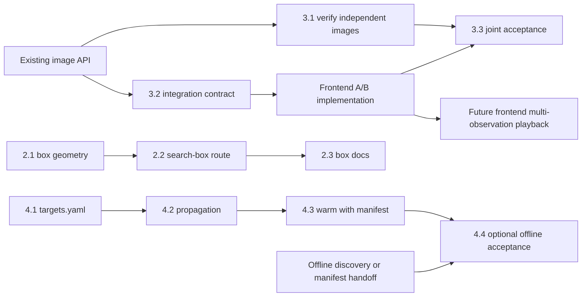

# Astrea backend — Tasks

- **Phase:** Tasks (spec-driven development: requirements → design → **tasks**)
- **Scope:** `backend/`
- **Inputs:**
  - [`design.md`](design.md): architecture, components, and decisions DD1–DD10
  - [`requirements.md`](requirements.md): SRCH, DATA, GEO, BLNK, OFF, NFR and AT requirements
  - [`spec.md`](spec.md): hardening REQ-1 to REQ-7 (done)
  - Blink design: [`../../superpowers/specs/2026-11-14-spherex-backend-fastapi-design.md`](../../superpowers/specs/2026-11-14-spherex-backend-fastapi-design.md)
  - Historical product goals G1–G7 and candidate acceptance targets (not an active architecture): [`../../superpowers/specs/2026-11-14-spherex-blink-viewer-design.md`](../../superpowers/specs/2026-11-14-spherex-blink-viewer-design.md)
- **Baseline:** `KC-Rama` at `5b74092` plus the `spec.md` hardening (131 tests passing).

## How to use this file

- Work within each phase's dependencies. Initial frontend blink can integrate
  the existing API now; it does not wait for Phase 1, box selection in Phase 2,
  or offline preparation in Phase 4.
- **Blink ownership:** the frontend selects observations, manages playback and
  applies one shared display scale. The backend serves each image's data and
  WCS projection. The active Blink spec wins over the historical product proposal.
- A/B is the initial interaction. Future sequences of three or more observations
  remain frontend-managed, using the same per-image API.
- Each task is one reviewable change (one PR or commit).
- Each task follows the module recipe in
  `2026-11-14-astrea-backend-technical-documentation.md` §13:

  ```
  schema → integration → service → wiring → route → errors → tests → API.md
  ```
- A task is **done** when:
  - its *Done when* items hold;
  - `python -m pytest tests -q` passes;
  - `API.md` and `design.md` match the code.
- Rules for every task:
  - Never change an existing response shape. Only add routes, or optional
    fields and parameters with defaults (D1).
  - No test may use the network. Live checks are manual and listed explicitly.
- Status markers: `[ ]` to do, `[~]` in progress, `[x]` done.

## Phase 0 — Done

- [x] **0.1** Image search, load, raw pixels, projection, stars and sky (`ef4f862`).
- [x] **0.2** Byte-range downloads, retries, extra planes, on-request corrections (`5b74092`).
- [x] **0.3** Hardening R1–R7: grid-aligned planes, download budget, layering,
  `RangeReader`, `MeshError` → 422, docs, split requirements ([`spec.md`](spec.md) T1–T8).

## Phase 1 — Foundations

### [x] 1.1 Settings from environment variables

- **Why:** deployment and demo machines need different cache paths, CORS
  origins and budgets without code edits (design §11).
- **Changes:**
  - `core/config.py`: add `Settings.from_env(environ=os.environ) -> Settings`.
    It reads `ASTREA_CACHE_DIR`, `ASTREA_STAR_CACHE`, `ASTREA_CORS_ORIGINS`
    (comma-separated), `ASTREA_BAD_FLAGS` and `ASTREA_ARCHIVE_BUDGET_SECONDS`.
    Unknown or invalid values raise at startup.
  - `application.py`: `create_app(settings=None)` uses `Settings.from_env()`
    when no settings are passed.
  - Reject `SOURCE` in `bad_flags` at startup. Today it is only skipped
    silently.
- **Done when:**
  - Every field can be overridden by environment variable.
  - Defaults are unchanged.
  - A bad value fails fast with a clear message.
- **Tests:** `tests/test_config.py`: defaults, each override, bad number, `SOURCE` rejected.
- **Refs:** NFR-9; D1, D8; roadmap step 2.

### [x] 1.2 Request timing logs

- **Why:** to see where time goes (search, ranges, fallback, decode,
  projection) before optimising (roadmap step 8).
- **Changes:**
  - Log one `INFO` line per archive operation:
    - `operation`, `image_id`
    - `bytes`, `seconds`
    - `path=ranges|service`, `retries`
  - Emit the line from `IrsaClient`; `ImageService` adds `image_id`.
  - Logs carry no secrets and only public URLs.
- **Done when:** one line per image or plane download, and a warning when the
  fallback was used.
- **Tests:** assert with `caplog` in `test_irsa_ranges.py` and `test_planes_api.py`.
- **Refs:** NFR-10; D6.

### [x] 1.3 Check the minimum dependency versions

- **Why:** the `>=` bounds in `requirements.txt` resolve, but the tests only
  ran on the newest releases (spec REQ-7).
- **Changes:**
  - Add `requirements-min.txt` with `==` at each lower bound.
  - Add a short "verify minimum versions" section to `environment.md`.
  - Raise any bound that fails.
- **Done when:** the suite passes on both the minimum and the latest sets.
  Record the result in `environment.md`.
- **Refs:** NFR-11; REQ-7.

### [x] 1.4 Product requirements document

- **Why:** `design.md` §16 traces to product goals because `requirements.md`
  does not exist yet.
- **Changes:** write `docs/sdd/backend/requirements.md` with EARS
  requirements for:
  - relevant G1–G7 goals, interpreted through the active prototype-style Blink spec;
  - the acceptance targets;
  - the non-functional goals D2–D7.

  Then update the traceability table in `design.md` §16.
- **Done when:** every task in Phases 2–3 names at least one requirement ID.

## Phase 2 — Box selection on the sky map (image search)

The user drags a rectangle on the 3D sky instead of clicking a single point.
The backend turns the rectangle into an ICRS centre and a cutout size, then
runs the existing image search. The geometry stays in the backend, so
coordinates have a single source of truth (same rule as the click search,
`POST /images/search`).

**Behaviour:**

- **Input:** the four corner directions of the dragged rectangle, in the
  scene frame (+X east, +Y up, −Z north), plus the same `observer`, `at`,
  `mode` and filters (`detector`, `limit`, `start_time`, `end_time`) as the
  click search.
- **Centre:** the normalised mean of the four corners' ICRS unit vectors.
- **Size:** the side of the north-aligned square that encloses the box in the
  tangent plane at the centre: `size_deg = 2 · max(|Δlon|, |Δlat|)` over the
  corners. A box rotated relative to north therefore gets a larger square
  that still covers all of it.
- **Limits:** the result must satisfy the existing `size_deg` rule
  (`0 < size ≤ 0.5°`):
  - A larger box returns 422 with the selected size and the maximum.
  - A box smaller than one SPHEREx pixel (6.15″) returns 422 asking the user
    to drag a larger box or click instead.
- **Search semantics:** unchanged. The search finds exposures that contain
  the box **centre**. Each cutout is the square above, so near an
  exposure edge the cutout may be clipped (`width`/`height` in the metadata
  are authoritative). Exposures that touch the box but not its centre are
  out of scope (task 5.7).

### [x] 2.1 Shared sky-direction geometry

- **Changes:** `services/image_geometry.py`:
  - `directions_to_icrs(directions, observer, at) -> SkyCoord`: a vectorised
    form of today's `click_to_icrs` logic. It validates that each vector is
    finite and non-zero, then converts AltAz → ICRS. `click_to_icrs` becomes
    a one-line wrapper with unchanged behaviour.
  - `box_selection(corners: SkyCoord) -> BoxGeometry(center, size_deg, corners)`,
    a pure function:
    - centre as above;
    - offsets via `center.skyoffset_frame()`;
    - `SelectionTooLarge` / `SelectionTooSmall` (both `ValueError`
      subclasses) when the size is outside the limits.
- **Done when:**
  - The click search behaves identically (existing tests unchanged).
  - `box_selection` handles the RA 0°/360° wrap, Dec ±89.9° and boxes
    rotated 45°.
- **Tests:** `tests/test_sky.py` (or a new `tests/test_box_selection.py`):
  - **Round trip:** build four ICRS corners around a known centre, turn them
    into scene directions with `calculate_sky`, recover the centre within 1″
    and the size within 1 %.
  - **Edge cases:** an RA wrap box centred at 359.99°, a box near the pole,
    and a 45°-rotated box (size = side × √2).
  - **Limits:** too large → `SelectionTooLarge`; corners closer than 6.15″
    → `SelectionTooSmall`; zero or non-finite vectors are rejected.
- **Refs:** SRCH-3, SRCH-4; G1, G7; D3, D6, D8.

### [x] 2.2 Box search schema, route and errors

- **Changes:**
  - `schemas/sky.py`: `BoxSearchRequest(ProjectionRequest)`:
    - `corners`: exactly four `direction` vectors, each component in [−1, 1];
    - `detector?`, `limit`, `start_time?`, `end_time?`, with the same rules
      as `ClickSearchRequest`;
    - `extra="forbid"`, no NaN/∞.
  - `schemas/images.py`:
    - `BoxSelection {center: SkyPosition, size_deg, corners: list[SkyPosition]}`;
    - `BoxSearchResponse(ImageSearchResponse)` adds `selection: BoxSelection`.
      The existing response models are unchanged.
  - `api/v1/endpoints/images.py`: `POST /api/v1/images/search-box`. It runs
    `directions_to_icrs`, then `box_selection`, then
    `ImageService.search(ImageSearchQuery(ra_deg, dec_deg, size_deg, …))`,
    and returns the result with `selection`.
  - `api/errors.py`:
    - `SelectionTooLarge` → 422: "The selected box spans N′; the maximum is
      30′. Zoom in or drag a smaller box."
    - `SelectionTooSmall` → 422: "The selected box is smaller than one pixel.
      Drag a larger box or click instead."
    - IERS errors keep their existing 422.
- **Done when:**
  - Searching by box returns the same `images` as `GET /images` with the
    computed centre and size.
  - IDs match, because they are built from the same `requested` geometry.
  - No FITS is downloaded during the search.
- **Tests:** `tests/test_images_api.py`, using the `FakeArchive`:
  - The archive receives the computed centre (±1e-6°) and `size_deg`.
  - `selection` is echoed back in the response.
  - Loading a returned ID works exactly as for click results.
  - Too large / too small → 422 with the messages above, and the archive is
    never contacted.
  - Malformed `corners` (3 or 5 vectors, a zero vector, NaN) → 422.
  - OpenAPI lists the new route.
- **Refs:** SRCH-3, SRCH-4, NFR-1, NFR-6; G1, G7; D1, D6.

### [x] 2.3 Box selection documentation and frontend contract

- **Changes:**
  - `API.md`: add a section "Box selection on the sky" with the request,
    the response, the limits and the search semantics.
  - Describe the frontend side:
    1. On drag end, compute the four screen-corner rays with
       `skyDirectionAtPointer`.
    2. Rotate each by `camera.quaternion`, exactly as for the click.
    3. Reject the box if any corner falls off the sky disc.
    4. Send the corners in drag order.
    5. Draw the returned `selection.corners`.
    6. Load results exactly as for a click.
  - `design.md` §4.1 (route table), §4.5 (geometry) and §6.2 (schemas).
  - Technical documentation §4.2 (a new "search by box" flow) and §14.
- **Done when:** the frontend team can implement box selection from `API.md`
  alone.
- **Refs:** SRCH-3, NFR-1; D1.

## Phase 3 — Support frontend blink with the existing API

The active Blink spec defines the contract. The frontend loads A and B,
positions each using its own WCS mesh, and alternates visibility. The backend
keeps serving independent observations. No `BlinkService`, `/api/v1/blink`,
common-grid resampling, backend-selected sequence or `suggested_stretch` is
required for this integration. Existing corrections are optional and default off.

These tasks cover backend verification and handoff only. They do not authorize
changes to frontend source or imply that playback is already implemented.

### [x] 3.1 Verify independent observation loading and projection

- **Changes:** add focused regression coverage where the existing tests do not
  already cover two observations loaded concurrently for one region.
- **Done when:**
  - A and B retain distinct IDs, dimensions, pixels, dates and WCS geometry.
  - Both can be projected with the same `observer`, `at` and `mode`.
  - Loading B cannot overwrite A's cached data; repeated reads use their caches.
  - No new response shape or blink-specific backend state is introduced.
- **Tests:** `test_images_api.py`: two synthetic observations with different
  WCS rotations, independent load/pixel/projection responses and cache reuse.
- **Refs:** BLNK-1, BLNK-2, BLNK-3; G1, G2; D1, D3, D5; active Blink spec §3–§4 and §8.

### [x] 3.2 Document the frontend integration contract

- **Changes:** complete the Blink integration section in `API.md` using existing
  `/images/search`, `/images/load/{id}`, `/images/{id}/pixels` and
  `/images/{id}/projection` routes.
- **Document:**
  - Selection of A/B with distinct observation times; optional same-detector
    filtering. A shared detector does not guarantee a shared wavelength.
  - `images`, `has_more`, current search limits and date filters. Never present
    the newest 20 results as complete observation history.
  - Independent textures/meshes, one observer/displayed time, live sample expiry,
    readiness and cancellation of stale requests.
  - One frontend-computed display scale shared across observations; preserve
    raw values so the scale can be recomputed when selection changes.
  - Existing corrections (`subtract_zodi`, `mask_flags`, `signal_to_noise`)
    remain opt-in. Use the same processing choices for compared observations;
    do not mix raw intensities with dimensionless signal-to-noise values.
  - Empty/one-image results, loading B while retaining A, and per-image errors.
  - More than two observations are future frontend work: ordered IDs, playback
    index, individual readiness and bounded loading, still using this API.
- **Done when:** the frontend team can implement the initial A/B interaction
  without relying on this chat or a new backend endpoint.
- **Refs:** BLNK-4, BLNK-5; G2; D1, D3, D6; active Blink spec §4–§8.

### [ ] 3.3 Joint integration acceptance (manual)

- **Owner:** frontend team implements playback; backend/data team verifies data
  contracts and diagnoses API failures. Coordinate testing without editing the
  other team's source.
- **Steps:** search one region, load A/B, project both at the same observer/time,
  then exercise Show A / Show B / Blink and a failed B load.
- **Done when:**
  - Both images are positioned by their own WCS and use one shared display scale.
  - The visible observation's date and detector remain identifiable.
  - Visibility switches do not trigger archive downloads.
  - Loading/error/empty states are usable; expired projections and stale
    selections do not continue playback.
  - Visual differences are not presented as confirmed scientific detections.
- Record test evidence. Mark this item complete only after the frontend
  integration is tested, not merely because the backend routes exist.
- **Refs:** BLNK-1–5; G2; active Blink spec §8.

## Phase 4 — Optional offline demo preparation (roadmap step 5)

This work improves demo availability; it is not a prerequisite for frontend
blink. Reuse `ImageService`, not a separate blink service. Candidate targets
from the historical proposal need live validation; their visibility or motion
is not guaranteed by implementing playback.

### [x] 4.1 Acceptance targets

- **Changes:**
  - `backend/targets.yaml`: the five targets with ICRS J2000 position, proper
    motion (mas/yr), `expected` and an optional `detector`.
  - **Manual check:** take every value from SIMBAD (or Sesame) and record the
    date in the file. Do not keep the approximate values from the Blink spec.
- **Done when:** each value has a source noted in a YAML comment.
- **Refs:** OFF-1, AT-1–5; G4, G5.

### [x] 4.2 Target propagation and route

- **Changes:**
  - Add `pyyaml` to `requirements.txt`.
  - `services/targets.py`: load and validate the YAML, then propagate with
    `SkyCoord.apply_space_motion` (angles only) to the configured epoch
    (2025.9, the middle of SPHEREx DR1; set in `targets.yaml`).
  - Additive route `GET /api/v1/targets` → `TargetsResponse` (documented in
    `API.md`). No blink-specific route is needed.
- **Done when:** Barnard's Star moves about 4.5′ between J2000 and 2025.9.
- **Tests:** `tests/test_targets.py`.
- **Refs:** OFF-1; G4.

### [x] 4.3 Warm command

- **Changes:**
  - `app/warm.py`: `python -m app.warm targets.yaml [--only NAME] [--fov 0.1] [--max-frames 12] [--offline]`.
  - Uses `ImageService.search` and loads the chosen observation IDs through
    `metadata` and `pixels`. Selection is an explicit demo preparation choice,
    not a new automatic selection rule imposed on the viewer.
  - Saves a manifest of target/query, observation IDs, dates and processing
    options. Report limited search coverage instead of claiming a full history.
  - In `--offline` mode, read that manifest and verify cached data without
    calling search. Current search still requires IRSA.
  - Prints one line per target: detector, frames, span in days, fetched,
    cached, failed.
  - `--offline` gives the client a session that raises on any network use.
- **Done when:**
  - The exit code is 1 when a target has fewer than 2 ready frames or any
    failures.
  - `--offline` succeeds for cached manifest entries after a warm run.
  - This verifies cached image availability, not offline browser discovery.
    A complete offline demo additionally needs a documented manifest handoff
    or cached search response path, implemented and tested separately.
- **Tests:** `tests/test_warm.py`: report format, exit codes, offline mode raises on network use.
- **Refs:** OFF-2, OFF-3, OFF-4; G3, G4; anti-goal "demo dies because IRSA is slow".

### [ ] 4.4 Acceptance run (manual)

- **Steps:**
  1. Run `warm` on the five targets.
  2. Note the span per target in this file.
  3. Run `warm --offline`.
  4. Only after an offline discovery/manifest handoff exists, start the API
     and walk the targets with the network disabled. Otherwise record the
     offline browser acceptance as pending, even if the CLI check passes.
- **Done when:**
  - Each accepted target has at least 2 ready observations with recorded dates.
  - Record whether the expected motion or brightness change is actually
    discernible with WCS placement and the shared display scale. Do not claim
    a detection from playback alone; document unsuitable targets or confounders.
  - No 5xx.
- **If a target fails:** try QR3, then the deep collections, then a
  per-target `detector`. Record the decision.
- **Refs:** AT-1–5, OFF-3; G5; product spec §13.

## Phase 5 — Later

| ID | Task | Notes | Refs |
| --- | --- | --- | --- |
| [ ] 5.1 | Pagination for `/images` | Cursor on `(t_min, url)`; `has_more` already exists | roadmap step 7 |
| [ ] 5.2 | Spectra at a sky point | Read `WCS-WAVE` by ranges; wavelength and bandwidth at the target for each frame | roadmap step 6 |
| [ ] 5.3 | Cache eviction and disk quota | LRU by access time over `image-cutouts/`; size limit in `Settings` | design §7 |
| [ ] 5.4 | Multi-worker safety | File locks (or a shared store) in place of in-process locks | roadmap step 9 |
| [ ] 5.5 | Gaia DR3 / WISE overlays | New `integrations/` client following the `catalog.py` pattern | roadmap step 10 |
| [ ] 5.6 | Settings for the remaining module constants | Move `MAX_SEARCH_ROWS`, `REQUEST_SECONDS`, `MAX_LAYOUTS` and the retry delays into `Settings` | design §11 |
| [ ] 5.7 | Box search by overlap | Also return exposures that intersect the box but not its centre (polygon `s_region` test or SIA `POLYGON`), with coverage per result | Phase 2 |
| [ ] 5.8 | Common-grid reprojection and difference analysis | Optional, separately specified processing for array subtraction/measurements; not needed for visual blink. Preserve the raw-image API | active Blink spec §9 |
| [ ] 5.9 | Broader observation discovery | Pagination/full-history search and time-spread selection if needed later; no mandatory backend-selected sequence for initial A/B | active Blink spec §9 |

## Dependency graph



Foundations, box selection and optional offline preparation are separate work
streams. None requires moving playback to the backend. Common-grid processing
is later work, not a dependency of frontend A/B or multi-observation playback.
