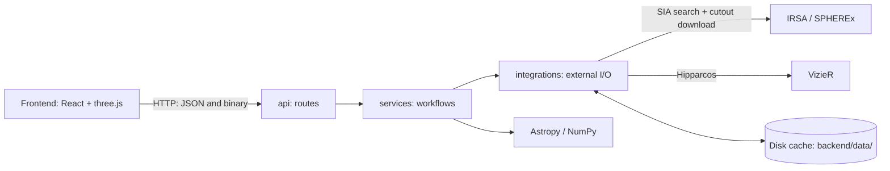
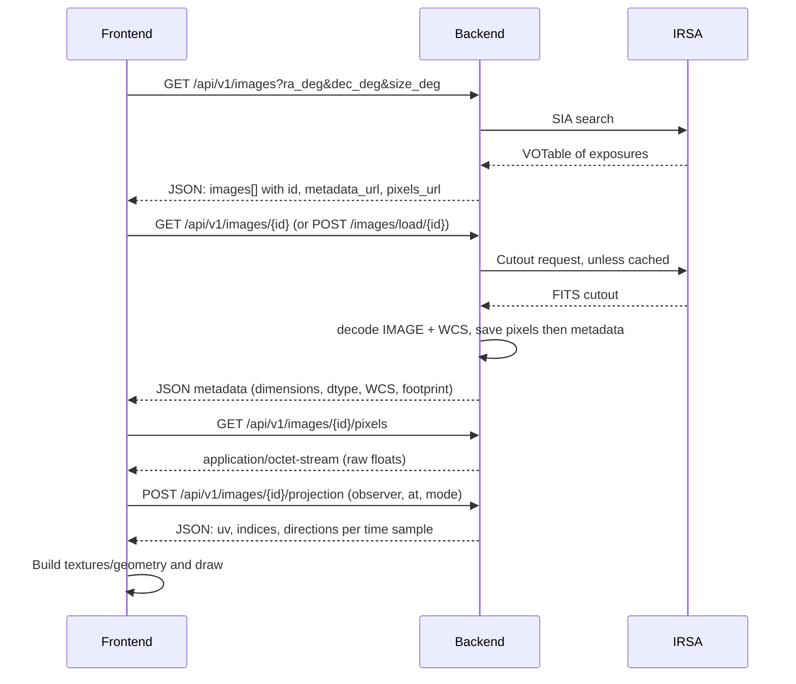

# Astrea backend — technical documentation and interpretation guide

**Component:** `backend/` (FastAPI service)

**Code reviewed:** branch `KC-Rama`: commit `5b74092` ("commit 2.0.1") plus the hardening in
[`docs/sdd/backend/spec.md`](../../sdd/backend/spec.md) (first written at `ef4f862`)

**Review date:** 2026-11-14

**Audience:** developers who extend the backend, and teammates who consume its
API from the frontend or need to interpret its data.

> This document describes what the backend **does today**. It keeps implemented
> behaviour apart from planned work (§16). Matrices, coordinates and responses
> shown as examples are illustrative, not verified astronomical measurements.
> Facts about IRSA marked *verified* were checked against the live archive on
> 2026-11-14. Archive contents change weekly.

## Contents

1. [Context and purpose](#1-context-and-purpose)
2. [Concepts needed to interpret the backend](#2-concepts-needed-to-interpret-the-backend)
3. [Architecture and file structure](#3-architecture-and-file-structure)
4. [Request flows](#4-request-flows)
5. [How data travels from backend to frontend](#5-how-data-travels-from-backend-to-frontend)
6. [Star catalog and observer sky](#6-star-catalog-and-observer-sky)
7. [IRSA integration](#7-irsa-integration)
8. [Cache, storage and concurrency](#8-cache-storage-and-concurrency)
9. [Errors and recovery](#9-errors-and-recovery)
10. [Configuration](#10-configuration)
11. [Specifications and current limits](#11-specifications-and-current-limits)
12. [Facts that matter for development](#12-facts-that-matter-for-development)
13. [How to add a feature module](#13-how-to-add-a-feature-module)
14. [Endpoint reference](#14-endpoint-reference)
15. [Running and verification](#15-running-and-verification)
16. [Roadmap](#16-roadmap)
17. [Glossary](#17-glossary)
18. [Sources and references](#18-sources-and-references)

## 1. Context and purpose

Astrea is a public web tool for exploring NASA SPHEREx images of the sky over
time. The backend is the only component that talks to external archives. It:

- **Discovers** SPHEREx Level 2 spectral images at IRSA for a sky position.
- **Downloads and decodes** a cutout of a selected image and returns its
  intensities as raw numbers, plus the metadata needed to interpret and place
  them.
- **Supplies context**: the Hipparcos star catalog (via VizieR), and the
  directions of stars and images as seen by an observer at a time and place on
  Earth.

The backend prepares data; it does not decide how the data looks. Contrast,
colour maps, opacity and drawing belong to the frontend (§5).

On request it also applies three corrections: quality masking (`FLAGS`),
background subtraction (`IMAGE − ZODI`) and signal-to-noise (`VARIANCE`). It
also serves those planes on their own. What it does **not** do yet:
reprojection, comparisons between epochs, spectra, or any photometric
measurement. The stars it serves come from a catalog. They are not
sources detected in the FITS image, and a catalog magnitude is not a flux
measured by SPHEREx.

## 2. Concepts needed to interpret the backend

### 2.1 Three coordinate spaces

| Space | Data | Used for |
| --- | --- | --- |
| Terrestrial | Latitude, longitude, elevation | Where the observer stands. Only needed for the local-sky features. |
| Celestial ICRS | Right ascension and declination (RA/Dec) | A direction in the sky, independent of the observer. All image searches use it. |
| Local AltAz / 3D scene | Altitude, azimuth, unit vector `(x, y, z)` | Where stars and images appear relative to the observer's horizon at an instant. |

- RA is in **decimal degrees**, `0 ≤ RA < 360`. Dec is in decimal degrees,
  `−90 ≤ Dec ≤ 90`. An RA in hours must be converted (`degrees = hours × 15`).
- `1° = 60′ (arcmin)`, `1′ = 60″ (arcsec)`.
- Scene convention for unit vectors: **+X = east, +Y = up, −Z = north**. Hence
  `altitude = asin(y)` and `azimuth = atan2(x, −z)`.

RA/Dec does not replace an observer location. Image search and download need
only RA/Dec. Placing an image on the local horizon also needs latitude,
longitude, elevation and time.

### 2.2 FITS, HDU and WCS

A FITS file can hold several extensions (**HDUs**). It is not a picture: it
carries intensities, quality bits, calibration data and lookup tables.

A SPHEREx Level 2 spectral image has, *verified*:

| HDU | Name | Content |
| --- | --- | --- |
| 0 | primary | Minimal header; `VERSION` (processing version) |
| 1 | `IMAGE` | float32 intensities in MJy/sr (2040×2040 for a full array) |
| 2 | `FLAGS` | int32 bitmask; flag names in `MSKNnnnn` header cards |
| 3 | `VARIANCE` | per-pixel variance |
| 4 | `ZODI` | zodiacal-light model, **not** subtracted from `IMAGE` |
| 5 | `EPSF` | PSF table for 441 detector regions |
| 6 | `WCS-WAVE` | lookup table for wavelength per pixel |

The backend reads `IMAGE` and its spatial WCS when an image is loaded.
`FLAGS`, `ZODI` and `VARIANCE` are read on demand, on the same pixel grid.
`EPSF` and `WCS-WAVE` are never downloaded.

**WCS** maps pixel coordinates to sky coordinates and back. SPHEREx uses
`RA---TAN-SIP`: a tangent projection plus SIP distortion polynomials. Each
exposure has its own rotation, so two images of the same patch are generally
not pixel-aligned.

### 2.3 Detector, channel and wavelength

SPHEREx has six detector arrays (D1–D6) covering about 0.75–5.0 µm. A
linear variable filter (LVF) makes wavelength change across each array.
Therefore:

1. One image is **one exposure of one array**. It is not 102 separate band
   images.
2. Its wavelength range is the range of the whole array, not the wavelength at
   a particular object.
3. Comparing observations requires the wavelength **at the same sky point**,
   not only the detector name.

### 2.4 Releases and collections

| SIA collection | Release label in the API | Notes |
| --- | --- | --- |
| `spherex_dr1` | `dr1` | Data Release 1, wide survey |
| `spherex_dr1_deep` | `dr1` | Deep fields |
| `spherex_qr3` | `qr3` | Quick Release 3, wide survey |
| `spherex_qr3_deep` | `qr3` | Deep fields |

The backend searches all four together. The `collection` field in responses
names the **release** (`dr1`/`qr3`), derived from the file path. It does not
say whether the image is from the wide or the deep survey: both use the same
path pattern (*verified*). *Verified* time coverage: DR1 rows at WISE 0855 span
MJD 60800–61174 (May 2025 – May 2026). QR3 rows near the north ecliptic pole
start at week `2026W30`.

## 3. Architecture and file structure

### 3.1 Responsibilities



| Layer | Folder | Rule |
| --- | --- | --- |
| Entry | `main.py`, `application.py` | Builds the app; no business logic. |
| Configuration | `core/` | Defaults in one frozen dataclass. |
| HTTP | `api/` | Validates input, calls a service, returns its result. Never touches IRSA or disk. |
| Contracts | `schemas/` | Pydantic models shared by routes and services. They define the public API. |
| Workflows | `services/` | Orchestration and science (FITS decoding, coordinates). No HTTP types. |
| External I/O | `integrations/` | IRSA, VizieR, local storage. Owns timeouts, URL allowlists and atomic writes. |

Dependencies point one way: `api → services → integrations`. Services are
created once in `create_app` and stored on `app.state`. Routes get them
through `api/dependencies.py`, which is also the seam tests use to swap in
fakes.

Requests are plain HTTP. There is no WebSocket and no per-frame streaming.
Every endpoint is a synchronous `def`, run in FastAPI's threadpool. That fits
the work, which is blocking I/O and CPU-bound numpy/astropy.

### 3.2 File structure

```text
backend/
├── API.md                     # Public contract of the image API
├── environment.md             # Setup, run and test instructions
├── requirements.txt
├── app/
│   ├── main.py                # ASGI entry: app = create_app()
│   ├── application.py         # create_app(settings): middleware, services, handlers, routers
│   ├── core/config.py         # Settings dataclass
│   ├── api/
│   │   ├── dependencies.py    # get_image_service, get_star_service
│   │   ├── errors.py          # Exception → HTTP status mapping
│   │   └── v1/
│   │       ├── router.py      # Registers feature routers
│   │       └── endpoints/
│   │           ├── images.py  # /images…
│   │           └── stars.py   # /stars, /star-catalog, /sky
│   ├── schemas/
│   │   ├── images.py          # Search query, summaries, image metadata
│   │   └── sky.py             # Observer, projection, sky and click requests
│   ├── services/
│   │   ├── images.py          # ImageService: search, register, lazy decode
│   │   ├── fits_image.py      # decode_cutout(), decode_plane(): FITS → bytes + metadata
│   │   ├── quality.py         # bad_bits(), corrected(): masking, zodi, signal-to-noise
│   │   ├── image_geometry.py  # click → ICRS, WCS mesh, image projection
│   │   ├── stars.py           # StarService: catalog load, cache, selection
│   │   ├── sky.py             # ICRS → AltAz with proper motion and IERS checks
│   │   └── sky_transport.py   # SKY1 binary encoding
│   └── integrations/
│       ├── irsa.py            # IrsaClient: SIA search, downloads, align_plane()
│       ├── irsa_ranges.py     # RangeReader: HTTP byte-range reads of single planes
│       ├── http_retry.py      # with_retries(), timeout_until(): retries and time budget
│       ├── cutout_store.py    # CutoutStore: selection/metadata/pixels on disk
│       └── catalog.py         # Hipparcos via VizieR
├── tests/                     # Offline pytest suite (§15)
└── data/                      # Generated at run time; git-ignored
    ├── hipparcos-v1.json
    └── image-cutouts/
```

`.venv/`, `__pycache__/` and `data/` are local artefacts, not source.

### 3.3 Module map

| File | Main symbols | Responsibility |
| --- | --- | --- |
| `application.py` | `create_app` | CORS (GET/POST), GZip ≥ 1000 B, service construction, exception handlers, router under `api_prefix`. |
| `core/config.py` | `Settings` | Name, version, prefix, cache paths, CORS origins. |
| `api/errors.py` | `register_exception_handlers` | Maps domain exceptions to HTTP status codes with a fixed public message. Logs tracebacks for 5xx. |
| `api/v1/endpoints/images.py` | `search_images`, `image_metadata`, `image_pixels`, `search_from_click`, `load_image`, `image_projection` | Image routes. The ID path parameter must match `^[0-9a-f]{64}$`. |
| `api/v1/endpoints/stars.py` | `stars`, `star_catalog`, `sky` | Catalog and observer-sky routes. |
| `services/images.py` | `ImageService.search/metadata/pixels` | Builds IDs, registers selections, downloads once per ID, validates and caches. |
| `services/fits_image.py` | `decode_cutout`, `InvalidFitsError` | Reads `IMAGE` and its celestial WCS; computes center, footprint, statistics and provenance. |
| `services/image_geometry.py` | `click_to_icrs`, `build_mesh`, `project_image` | Click vector → RA/Dec; adaptive WCS mesh; local directions for an image. |
| `services/sky.py` | `observation_context`, `calculate_sky`, `horizon_vectors` | Time samples, IERS coverage check, AltAz transform. |
| `services/sky_transport.py` | `encode_sky` | SKY1 packet. |
| `services/stars.py` | `StarService` | Loads Hipparcos once (disk, then VizieR), computes `catalog_version`. |
| `integrations/irsa.py` | `IrsaClient.search/download_cutout/download_plane`, `align_plane`, `ArchiveImage` | SIA via astroquery, URL allowlist, one time budget per download, byte ranges first, cutout service as fallback. |
| `integrations/irsa_ranges.py` | `RangeReader`, `RemoteExposure`, `pixel_window`, `grid_origin` | Reads headers, then only the rows of one plane; owns its HTTP session and layout cache. |
| `integrations/http_retry.py` | `with_retries`, `timeout_until`, `is_transient` | Two spaced retries for 429/5xx and dropped connections; never past the deadline. |
| `integrations/cutout_store.py` | `CutoutStore` | Atomic files keyed by image ID: selection, image and extra planes. |
| `services/quality.py` | `bad_bits`, `corrected` | Pure corrections: flag names → bitmask (never `SOURCE`), zodi subtraction, signal-to-noise. |
| `integrations/catalog.py` | `fetch_catalog`, `parse_hipparcos_catalog` | VizieR query and row validation. |

## 4. Request flows

### 4.1 Search by RA/Dec

```http
GET /api/v1/images?ra_deg=210.80227&dec_deg=54.34895&size_deg=0.1&detector=2&limit=20
```

1. FastAPI validates `ImageSearchQuery`: unknown fields, NaN and infinity are
   rejected, and `start_time ≤ end_time` must hold.
2. `ImageService.search` converts the dates to MJD and calls
   `IrsaClient.search`.
3. IRSA SIA is queried with a **1-arcsecond cone** around the point, across
   the four collections, `MAXREC=10000` (§7.1).
4. Rows are filtered (detector, start time), deduplicated by URL, sorted
   newest first, and cut to `limit + 1`. The extra row signals `has_more`.
5. For each kept row, the service builds an ID (§4.4) and **registers** the
   selection on disk. No FITS is downloaded.

`size_deg` is the side of the square cutout requested later. It is **not** a
search radius: the search finds exposures that contain the point, not every
exposure that touches the square.

### 4.2 Search by sky click

`POST /api/v1/images/search` receives a direction vector, the observer, the
displayed time `at`, `size_arcmin` (default 6, max 30), plus `detector`,
`limit` and date filters. `click_to_icrs` normalises the vector, rebuilds
azimuth and altitude, and transforms them to ICRS with the same airless AltAz
frame as the stars. It then runs the same search as §4.1 with
`size_deg = size_arcmin / 60`. `at` is the time of the displayed sky, not an
exposure filter.

### 4.3 Load, pixels and projection



Calling `/pixels` first also triggers the download. Every path goes through
`ImageService.metadata`.

### 4.4 Image IDs

```text
id = sha256(json({"format_version": 1,
                  "source_url": <archive FITS URL>,
                  "requested": {"ra_deg", "dec_deg", "size_deg", "frame": "ICRS"}},
                 sort_keys=True)).hexdigest()      # 64 hex characters
```

An ID identifies **one cutout geometry of one file**. It is not a universal
exposure identifier: the same FITS with a different centre or size gets a
different ID. Bumping `format_version` invalidates every ID, which is how the
cache format is versioned.

## 5. How data travels from backend to frontend

### 5.1 Three flows

| Flow | In Python | Over HTTP | In JavaScript |
| --- | --- | --- | --- |
| Stars | NumPy direction arrays + catalog metadata | JSON, or `SKY1` (JSON header + float32) | `Float32Array` + metadata |
| Image intensities | 2D NumPy array | `application/octet-stream` | `Float32Array` / `Float64Array` |
| Image mesh and projection | UVs, indices, directions | JSON | Arrays → typed arrays for the GPU |

No PNG is sent. The browser receives numbers and decides how to display them.

### 5.2 Pixel payload

`decode_cutout` takes the `IMAGE` array exactly as stored:

```text
data.shape = (height, width)
data[row, column] = intensity of that pixel (normally MJy/sr)
```

Serialization is `array.tobytes(order="C")`, little-endian:

```text
[[10, 20, 30],
 [40, 50, 60]]   →   [10, 20, 30, 40, 50, 60]

index = row × width + column
bytes = width × height × 4  (float32)  or  × 8  (float64)
```

- **dtype:** float32 inputs stay float32. float64 is not downcast. Integer
  planes become float64 so that their values are represented exactly.
- **Row 0 is the lower FITS row** (`pixel_origin: "lower-left"`). A canvas
  draws top to bottom, so 2D drawing needs a vertical flip. The WebGL path
  uses `flipY = false` together with the mesh UVs.
- **No processing by default:** negative values, NaN and ±∞ are preserved. No
  stretch, colour map, reprojection or downsampling is ever applied.
  Background subtraction, FLAGS masking and signal-to-noise happen only when
  requested (`subtract_zodi`, `mask_flags`, `signal_to_noise`; see `API.md`
  §4). Non-finite samples should be drawn transparent.
- **Size:** a 0.1° cutout is about 59×59 px, ~14 KB. A 0.2° cutout is
  117×117, ~55 KB (*verified* dimensions at 6.15″/px).

Decoding in the browser, without assuming native byte order:

```javascript
const view = new DataView(buffer);
const values = new Float32Array(width * height);
for (let i = 0; i < values.length; i += 1) values[i] = view.getFloat32(i * 4, true);
const value = values[row * width + column];
```

The frontend should check that `buffer.byteLength === width × height × bytesPerSample`
before using the data.

### 5.3 Metadata contract (`ImageMetadata`)

`GET /api/v1/images/{id}` repeats the search entry and adds `image`:

| Group | Fields |
| --- | --- |
| Identity | `id`, `observation_id`, `detector`, `collection`, `source_url` |
| Observation time | `observation.start_mjd/end_mjd/start_utc/end_utc` (from SIA `t_min`/`t_max`) |
| Request | `requested.ra_deg/dec_deg/size_deg/frame` |
| Resources | `metadata_url`, `pixels_url` |
| Layout | `image.width`, `height`, `dtype`, `byte_order`, `array_order`, `pixel_origin` |
| Values | `image.unit` (BUNIT), `finite_min`, `finite_max`, `nonfinite_count` |
| Position | `image.center` (actual centre, may differ from `requested`), `image.footprint` (outer-edge corners LL, LR, UR, UL) |
| Geometry | `image.wcs_header`: celestial WCS cards including SIP terms; FITS 1-based `CRPIX` |
| Provenance | `image.fits_metadata`: `observation_id`, `detector`, `processing_version`, selected `header_fields` (OBSID, DETECTOR, VERSION, DATE*, MJD*, TIMESYS, EXPTIME…) |

Near the edge of an exposure, `width`/`height` can be smaller than requested.
The statistics are descriptive only and are **not** a recommended stretch.

### 5.4 Mesh and projection

A rectangle pasted onto a sphere ignores the WCS projection and distortion.
`build_mesh` therefore creates a vertex grid with UVs on **pixel edges**
(`−0.5` offset, because astropy puts integer coordinates at pixel centres). It
refines through 8, 16, 32, 64 and 128 segments per side until triangle
interpolation agrees with the WCS within **0.15 native pixel**, and fails
beyond that.

`POST /api/v1/images/{id}/projection` returns:

```text
image_id, mesh_segments, mesh_error_pixels
uv:                [u0, v0, u1, v1, ...]
indices:           [a0, b0, c0, ...]               (triangles)
sample_times_ms:   [t0, ..., t(T-1)]
directions:        T rows of [x0, y0, z0, x1, ...]  (V vertices × 3)
center_directions: T rows of [x, y, z]
```

### 5.5 SKY1 star packet

`POST /api/v1/sky` with `format: "binary"` returns
`application/vnd.astronomy.sky+octet-stream`:

```text
Offset  Size          Content
0       4 bytes       ASCII "SKY1"
4       4 bytes       header length H, uint32 little-endian
8       H bytes       UTF-8 JSON, space-padded to a multiple of 4
8 + H   T × N × 3 × 4 float32 little-endian directions, sample/star/xyz order
```

The header carries everything in the JSON snapshot except `directions`, plus
`direction_encoding: "float32-le"`. The padding lets the browser create a
`Float32Array` view on the buffer without copying. Example: 2 stars × 2 samples
→ 48 numeric bytes.

## 6. Star catalog and observer sky

- **Source:** Hipparcos `I/239/hip_main` from `vizier.cfa.harvard.edu`, with
  columns HIP, RAICRS, DEICRS, Vmag, B−V, pmRA, pmDE and a 30 s timeout. The
  download must return exactly **118 218** rows, otherwise it is rejected as
  incomplete.
- **Epoch:** the native ICRS epoch **J1991.25** is kept. The CDS epoch-2000
  derived columns are not used. Proper motions are converted to arcsec/yr
  using the units of the response.
- **Order:** by magnitude, then HIP ID. Every magnitude selection is a prefix
  of this order, so star indices line up between `/star-catalog` and `/sky`.
- **Version:** `catalog_version = "hipparcos-v1-" + sha256(stars)[:20]`. A
  `/sky` request carrying a stale version gets **409**. The client then
  reloads the catalog and retries.
- **Sky model:** proper motion is applied to each sample time (angles only, no
  parallax), then ICRS → AltAz with **no refraction** (`pressure = 0`).
  `paused` gives 1 sample. `live` gives 13 samples, 10 s apart, over 120 s.
- **IERS guard:** if Earth-orientation data does not cover the requested time,
  the API returns **422**. It never silently extrapolates.
- **Limitations** (also returned in the snapshot): no atmospheric refraction,
  stellar parallax, terrain or daylight visibility model.

## 7. IRSA integration

### 7.1 Search (`IrsaClient.search`)

| Aspect | Behaviour |
| --- | --- |
| Client | `astroquery.ipac.irsa.Irsa().query_sia`, endpoint `https://irsa.ipac.caltech.edu/SIA` |
| Position | `pos=(ra, dec, 1/3600)`: a 1″ cone, as in the IRSA intro notebook |
| Collections | `spherex_dr1`, `spherex_dr1_deep`, `spherex_qr3`, `spherex_qr3_deep` in one call |
| Row cap | `maxrec=10000`. An overflow warning or ≥ 10 000 rows → `SearchTooBroad` (422) |
| Dates | Upstream `TIME` (interval overlap) plus a local filter on **start** time, both bounds inclusive |
| Detector | Parsed from `energy_bandpassname` (`SPHEREx-D1`…`D6`); filtered locally |
| Required | Rows without `t_min` are dropped |
| Dedupe | By `access_url` (the same file can appear in a wide and a deep collection) |
| Order | `t_min` descending, URL as tiebreak; returns `limit + 1` |
| Transport guard | A custom adapter allows only `https://irsa.ipac.caltech.edu/SIA[/capabilities]` and adds a `(10 s, 60 s)` timeout, which astroquery would otherwise omit |
| URL allowlist | `access_url` must match `https://irsa.ipac.caltech.edu/ibe/data/spherex/(dr1\|qr3)/level2/…\.fits`, with no query string and no `.`/`..` segments. Deep collections use the same pattern (*verified*) |

### 7.2 Downloads (`IrsaClient.download_cutout`, `download_plane`)

**Primary path: HTTP byte ranges** (`RangeReader`). The reader fetches the
file's headers first (16 FITS blocks), then only the rows of the requested
window, one plane at a time. A 10′ image costs about 85 kB and 2 s, against
about 4.1 MB and 6–10 s from the cutout service (measured in `API.md`). FLAGS
is tile-compressed, one tile per detector row, so it costs whole rows. A
response other than 206 is never read, so the 60 MB file is never downloaded.

**Planes follow the image's grid.** `download_plane` receives the loaded
image's `(CRPIX1, CRPIX2, width, height)`. The window origin is
`CRPIX_detector − CRPIX_image`, so a plane always lines up with the image's
pixels, however the image was obtained.

**Fallback: the IBE cutout service**, used when ranges are not honoured or
the layout is unexpected:

```text
GET {access_url}?center={ra:.12f},{dec:.12f}d&size={size_deg}&gzip=false
```

A plane taken from the service is cut out or padded onto the image grid by
`align_plane`. Samples the service did not cover are NaN for float planes and
carry the `MISSING_DATA` bit for FLAGS. Network errors do not trigger the
fallback, because the service would hit the same outage.

| Limit | Value |
| --- | --- |
| Time budget | 120 s per download (image or plane), covering every request, retry wait and fallback (`Settings.archive_budget_seconds`) |
| Per request | connect 10 s, read 40 s (shortened to the remaining budget), 90 s per request |
| Max size | 80 MiB (cutout service) |
| Redirects | Rejected |
| Content check | The service body must start with `SIMPLE  =` |
| Retries | Two, after 1 s and 2.5 s (a `Retry-After` up to 5 s is honoured), for 429/5xx and dropped connections. Timeouts are not retried. No wait starts past the budget |

Full files are about 64 MB (`access_estsize` ≈ 65 000 KB). The backend never
downloads them, nor the `EPSF` table.

## 8. Cache, storage and concurrency

### 8.1 Layers

| Location | Content | Notes |
| --- | --- | --- |
| `backend/data/hipparcos-v1.json` | Parsed catalog + identity fields | Rebuilt from VizieR if missing or the identity does not match. A write failure only logs a warning. |
| `StarService` memory | Stars + metadata | Lost on restart. |
| `backend/data/image-cutouts/{id}.selection.json` | Archive row + requested geometry | Written at search time. Required by every other image endpoint. |
| `…/{id}.pixels.bin` | Decoded raw floats | Written first. |
| `…/{id}.metadata.json` | Validated `ImageMetadata` | Written **last**. It is the completion marker, so a reader never uses partial pixels. |
| `…/{id}.{flags,zodi,variance}.bin` + `.json` | One extra plane on the image grid + its description | Written on first use of that plane, binary first. |
| `IrsaClient.ranges` memory | Layouts of up to 256 remote files (headers + spare bytes) | Per app instance; evicted least-recently-used. |

The full FITS is **not** persisted. IDs survive a restart while the directory
exists. A cleared ID returns 404 until a new search registers it again. There
is no quota and no eviction. To clear the cache, stop the server and delete the
generated directory. Both paths are already in the root `.gitignore`.

### 8.2 Write and read rules

- Atomic writes: temp file in the same directory → `os.replace`. On error the
  temp file is removed.
- Unreadable metadata JSON is treated as missing. The image is then downloaded
  and decoded again.
- Unreadable selection → `CacheError` (503). Invalid ID format →
  `UnknownImageError` (404).

### 8.3 Concurrency

`ImageService` holds a pool of 32 locks, chosen by
`int(id[:8], 16) % 32`. Concurrent requests for the same ID in one worker
download once. Two different IDs may share a lock and wait for each other,
which is harmless. Separate Uvicorn workers can download the same image
concurrently. The result stays consistent because publication is atomic.

## 9. Errors and recovery

### 9.1 Status mapping (`api/errors.py`)

| Exception | Status | Public `detail` |
| --- | --- | --- |
| Request validation (Pydantic) | 422 | FastAPI's structured list |
| `SearchTooBroad` | 422 | Too many archive matches. Narrow start_time/end_time and retry. |
| `EarthOrientationUnavailable` | 422 | Time outside Earth-orientation data. |
| Stale `catalog_version` | 409 | The star catalog changed… |
| No stars at magnitude limit | 422 | No catalog stars match this magnitude limit. |
| `UnknownImageError` | 404 | Unknown image. Run an image search first. |
| `ArchiveError` | 502 | IRSA data could not be retrieved. |
| `InvalidFitsError` | 502 | IRSA returned an unsupported or invalid FITS image. |
| `CatalogError` | 502 | The star catalog could not be retrieved. |
| `CacheError` | 503 | The local image cache is unavailable. |
| `MeshError` | 422 | This image's WCS cannot be projected accurately. Try a smaller size. |
| `ArchiveTimeout` | 504 | IRSA timed out (also when the 120 s download budget runs out). |

The handler picks the most specific class through the exception's MRO, so
`ArchiveTimeout` (a subclass of `ArchiveError`) maps to 504. Tracebacks of 5xx
errors go to the server log and never into the response. The frontend must
accept both `detail` shapes: a string, or the 422 validation list.

### 9.2 Reading failures

| Symptom | Meaning | Useful action |
| --- | --- | --- |
| `404` on `/images/{id}` | ID not registered on this backend (cache cleared or never searched) | Search again |
| `502` on load | IRSA error, or a FITS without `IMAGE`/celestial WCS | Read the log; try another exposure |
| `504` on load or plane | A read timeout, or the 120 s download budget ran out | Offer a manual retry. Brief 5xx/429 failures were already retried twice |
| `422` "Too many archive matches" | Over 10 000 SIA rows | Add `start_time`/`end_time` |
| `422` on `/sky` or `/projection` | Time not covered by IERS data | Use a recent time or refresh IERS |
| `422` on `/projection` "cannot be projected accurately" | The WCS distortion needs a finer mesh than 128 segments (`MeshError`) | Try a smaller size |
| `502` on `/star-catalog` | VizieR failure or incomplete catalog. Not IRSA | Check connectivity to VizieR |
| `OPTIONS → 200` | CORS preflight succeeded | Says nothing about the request that follows |

## 10. Configuration

`app/core/config.py`, frozen dataclass. **No environment-variable or `.env`
loading yet.** Tests pass a custom `Settings` to `create_app`.

| Field | Default |
| --- | --- |
| `app_name` | `Astrea API` |
| `app_version` | `0.1.0` |
| `api_prefix` | `/api/v1` |
| `cutout_cache_dir` | `backend/data/image-cutouts` |
| `star_cache_path` | `backend/data/hipparcos-v1.json` |
| `cors_origins` | `http://localhost:5173`, `http://127.0.0.1:5173` |
| `bad_flags` | `DEFAULT_BAD_FLAGS`: TRANSIENT, OVERFLOW, SUR_ERROR, NONFUNC, MISSING_DATA, HOT, COLD, PERSIST (`SOURCE` is never masked) |
| `archive_budget_seconds` | `120.0` |

Constants that behave like configuration but live in modules:

| Constant | Where | Value |
| --- | --- | --- |
| `SIA_COLLECTIONS` | `integrations/irsa.py` | the four collections above |
| `MAX_SEARCH_ROWS` | `integrations/irsa.py` | 10 000 |
| `MAX_DOWNLOAD_BYTES` / `DOWNLOAD_SECONDS` | `integrations/irsa.py` | 80 MiB / 90 s |
| `HEADER_GUESS` / `MAX_RANGES` / `MERGE_GAP` / `REQUEST_SECONDS` / `MAX_LAYOUTS` | `integrations/irsa_ranges.py` | 16 blocks / 96 / 256 B / 90 s / 256 |
| `RETRY_STATUS` / `RETRY_DELAYS` / `MAX_RETRY_AFTER` | `integrations/http_retry.py` | 429, 500, 502, 503, 504 / 1 s, 2.5 s / 5 s |
| `MAX_IMAGE_PIXELS` | `services/fits_image.py` | 4096² |
| `SAMPLE_INTERVAL_SECONDS` / `LIVE_WINDOW_SECONDS` | `services/sky.py` | 10 / 120 |
| `CATALOG_ROWS` / `MAX_MAGNITUDE` | `integrations/catalog.py` | 118 218 / 15 |

## 11. Specifications and current limits

| Parameter | Limit |
| --- | --- |
| `ra_deg` | `0 ≤ ra < 360`, finite |
| `dec_deg` | `−90 ≤ dec ≤ 90`, finite |
| `size_deg` (GET search) | `0 < size ≤ 0.5` |
| `size_arcmin` (click search) | `0 < size ≤ 30`, default 6 |
| `detector` | 1–6 or omitted (all) |
| `limit` | 1–100, default 20; no pagination |
| `start_time` / `end_time` | ISO 8601 **with timezone**; date-only rejected |
| `magnitude_limit` | −2 to 15, default 7 |
| `observer.elevation_m` | −500 to 10 000 |
| Search cone | 1″ |
| SIA rows | < 10 000 |
| Download | ≤ 120 s per image or plane (budget); ≤ 90 s per request; ≤ 80 MiB from the cutout service |
| Decoded image | 2D, ≤ 4096×4096 px |
| Mesh | ≤ 128 segments per side, error ≤ 0.15 px |
| Response compression | GZip for bodies ≥ 1000 B |

## 12. Facts that matter for development

Checked against IRSA on 2026-11-14 unless marked otherwise.

1. **`obs_id` is one exposure across all six arrays**: `2025W19_1B_0116_1`
   exists as D3 and D6. A file is identified by its URL, or by
   `(obs_id, detector)`, never by `obs_id` alone.
2. **The detector comes from SIA** (`energy_bandpassname`). Parsing the file
   name is not needed.
3. **Observation time = SIA `t_min`/`t_max` (MJD)**, or header
   `MJD-BEG/MJD-AVG/MJD-END`. Header `DATE` is the *processing* date (example:
   `2026-07-17` for a `2025-05-05` exposure). The code already keeps `DATE`
   out of observation times.
4. **SIA `em_min`/`em_max` are in metres** (`1.63e-06` = 1.63 µm).
5. **`dataproduct_subtype` is `science`** for spectral images.
6. **SIA `RESPONSEFORMAT=JSON`** returns a VOTable translated to JSON, not
   plain rows. Use VOTable (astroquery does this by default).
7. **Pixel scale** is ~6.15″ (`s_pixel_scale`). Each exposure has its own
   rotation and SIP distortion.
8. **Cutouts keep all extensions.** Requests are fast (~4 s for 0.2°), but
   IRSA can answer `503 Server busy` with `Retry-After` (seen during the
   prototype review).
9. **FLAGS bit names are in the header** (`MSKN0000 = TRANSIENT`, …,
   `MSKN0021 = SOURCE`, …). `SOURCE` marks pixels on *known sources*. Any
   future quality mask must not hide them, or it would hide the stars.
10. **`ZODI` is not subtracted** from `IMAGE`. Background levels therefore
    differ between epochs, which matters for any comparison over time.
11. **SIA lags ingestion by about a day**; ingestion is weekly. Never commit an
    SIA fixture without a date in its name.
12. **Proper motion is large for the acceptance targets**: Barnard's Star
    moves ~10.4″/yr, so a J2000 position is ~4.4′ off by 2025.6.

## 13. How to add a feature module

The structure is designed for features added step by step without touching
existing ones. Recipe, using a hypothetical `spectra` feature:

1. **Schema** — `app/schemas/spectra.py`: request/response models with
   `ConfigDict(extra="forbid", allow_inf_nan=False)`, like the existing ones.
2. **Integration** (only if it needs new external I/O) —
   `app/integrations/<source>.py`: timeouts, URL allowlist, domain exceptions
   (subclass `ArchiveError` where it fits). Reuse `IrsaClient` and
   `CutoutStore` before adding new clients.
3. **Service** — `app/services/spectra.py`: a class receiving its
   dependencies in `__init__` (no globals), with pure functions for the science
   so they can be unit-tested without HTTP.
4. **Wiring** — construct it in `create_app` (`app.state.spectra_service = …`)
   and add `get_spectra_service` in `api/dependencies.py`.
5. **Routes** — `app/api/v1/endpoints/spectra.py` with
   `APIRouter(prefix="/spectra", tags=["spectra"])`; register it in
   `api/v1/router.py`. Routes stay thin: validate, call, return.
6. **Errors** — add new exceptions to the mapping in `api/errors.py`. Never
   leak upstream messages.
7. **Cache** — store under `settings.<feature>_cache_dir`, written atomically.
   Put a version in IDs/keys so format changes invalidate cleanly. Add the
   directory to `.gitignore`.
8. **Tests** — `tests/test_spectra*.py`: unit tests for the pure functions,
   plus API tests with `create_app(Settings(<tmp dirs>))` and a fake
   integration swapped on `app.state`, as `test_images_api.py` does.
9. **Docs** — add the contract to `API.md` and a line to §14 here.

Rules that keep features independent:

- A new feature does **not** change existing response shapes. It adds new
  routes or optional fields with defaults.
- Science lives in services, I/O in integrations. A route never imports from
  `integrations/` directly.
- Breaking changes go to a new prefix (`/api/v2`), registered beside `v1`.

## 14. Endpoint reference

All paths are prefixed with `/api/v1`.

| Method | Path | Input | Output and purpose |
| --- | --- | --- | --- |
| GET | `/images` | `ra_deg`, `dec_deg`, `size_deg`, `detector?`, `limit?`, `start_time?`, `end_time?` | `ImageSearchResponse`: discovery only, newest first, `has_more` |
| POST | `/images/search` | `direction`, `observer`, `at`, `mode`, `size_arcmin`, `detector?`, `limit?`, dates | Same response, from a sky click |
| GET | `/images/{id}` | — | `ImageMetadata`; downloads and decodes on first access |
| POST | `/images/load/{id}` | empty body | Same as `GET /images/{id}` |
| GET | `/images/{id}/pixels` | `subtract_zodi?`, `mask_flags?`, `signal_to_noise?` (default false) | `application/octet-stream`, raw floats unless corrections are requested |
| GET | `/images/{id}/planes/{plane}` | `plane` = `flags`\|`zodi`\|`variance` | `PlaneMetadata`: layout, unit, `flag_bits`, `masked_flags`, `masked_bits` |
| GET | `/images/{id}/planes/{plane}/pixels` | — | `application/octet-stream` on the image grid: int32 flags, float32 zodi/variance |
| POST | `/images/{id}/projection` | `observer`, `at`, `mode` | Mesh UVs, indices and directions per time sample |
| GET | `/stars` | `magnitude_limit?` | Hipparcos stars (JSON) |
| GET | `/star-catalog` | — | Catalog version and static render metadata |
| POST | `/sky` | `observer`, `at`, `mode`, `magnitude_limit`, `format`, `catalog_version?` | Directions as JSON or SKY1 |
| GET | `/docs`, `/redoc`, `/openapi.json` (no prefix) | — | Generated documentation |

`/` returns 404 on purpose. The detailed image contract is in `backend/API.md`.

## 15. Running and verification

From `backend/` with the virtual environment active (see `environment.md`):

```bash
python -m uvicorn app.main:app --reload        # http://127.0.0.1:8000, docs at /docs
python -m pytest tests -q                      # offline test suite
```

Importing the app does not start a server or contact IRSA or VizieR.

Test suite (all offline; IRSA and VizieR are replaced by fakes or mocks):

| File | Covers |
| --- | --- |
| `test_irsa.py` | Search filtering/order/extra row, invalid input never reaches the network, timeout mapping, URL allowlist, cutout params, redirect/size/non-FITS rejection, truncation, service retry |
| `test_irsa_ranges.py` | Window reads reproduce the exposure's pixels, compressed FLAGS, planes on the given grid (also shifted), layouts per reader, multipart parsing, refusing non-206, retries, fallback and no fallback on outages, `align_plane` padding/cropping, time budget |
| `test_planes_api.py` | Plane metadata and flag bits, plane pixels downloaded once, corrections and their combinations, masking policy (`SOURCE` never), error mapping |
| `test_fits_image.py` | Pixel order and values incl. NaN/∞, WCS with rotation and SIP, outer-edge footprint, provenance and `DATE` semantics, float64 not downcast, rejection of corrupt/missing/non-celestial/cube/oversized images |
| `test_images_api.py` | Search without download, single download per ID, pixels-first and restart survival, ID stability, truncation, empty results, timezone dates, validation, 404, upstream status mapping, invalid FITS not cached, OpenAPI, click→load→pixels→projection, unprojectable WCS → 422, star routes |
| `test_sky.py` | Hipparcos epoch/units/missing data, catalog cache across restart, click inverts a rendered star direction, JSON and SKY1 agree, invalid clicks |

Passing tests do not prove that IRSA or VizieR are available live, or that a
scientific comparison is accurate.

## 16. Roadmap

This is a list of planned steps, **not** implemented features. Each step
follows the recipe in §13 and leaves existing endpoints unchanged.

| Step | Feature | Notes |
| --- | --- | --- |
| 1 | **Download resilience** — *done* | Retries for 429/5xx and dropped connections, honouring `Retry-After`; one time budget per download; `MeshError` → 422. |
| 2 | **Configuration from environment** | `ASTREA_*` env vars for cache dirs, CORS, limits. Move module constants into `Settings`. |
| 3 | **Quality and background variants** — *done* | `mask_flags` (by flag *name*, never `SOURCE`), `subtract_zodi` and `signal_to_noise` on `/pixels`; plane endpoints for flags, zodi and variance. Raw `/pixels` is unchanged. |
| 4 | **Blink (epoch comparison)** | One detector, frames spread over the time baseline, reprojected onto a common north-up grid, returned as float32. The frontend applies one shared stretch. Design: [`2026-11-14-spherex-backend-fastapi-design.md`](2026-11-14-spherex-backend-fastapi-design.md). |
| 5 | **Pre-warm command** | CLI that fills the cache for the acceptance targets (Barnard's Star, ε Indi B, WISE 0855, RW Aur, R Dra), with proper-motion propagation. Needed for an offline demo. |
| 6 | **Spectra** | Wavelength at the target from `WCS-WAVE` (requires keeping that extension). |
| 7 | **Pagination and full history** | Search beyond `limit`; date-window paging. |
| 8 | **Observability** | Timings for search, download, decode and projection in logs. |
| 9 | **Shared state for scale** | Multi-worker or multi-host cache and locks, quotas, eviction. |
| 10 | **Overlays** | Gaia DR3 / WISE catalog overlays. |

## 17. Glossary

| Term | Meaning here |
| --- | --- |
| AltAz | Local altitude/azimuth coordinates. |
| Cutout | Spatial subsection of an exposure, cut by IRSA's service. |
| Detector / array | One of SPHEREx's six arrays (D1–D6). |
| DR1 / QR3 | SPHEREx releases; not detectors, not wide/deep. |
| Endianness | Byte order inside a binary number. The API uses little-endian. |
| Epoch | The time of an observation (MJD/UTC). |
| FITS / HDU | Astronomical file format / one header + data unit inside it. |
| FLAGS | Per-pixel quality bitmask extension. |
| ICRS | Celestial reference system for RA/Dec. |
| IERS | Earth-orientation data needed for precise time/coordinate transforms. |
| IRSA | NASA/IPAC Infrared Science Archive, which serves SPHEREx data. |
| LVF | Linear variable filter: wavelength varies across the array. |
| MJD | Modified Julian Date. |
| SIA | Simple Image Access (IVOA) discovery protocol. |
| SIP | Polynomial distortion convention in WCS. |
| SKY1 | Astrea's binary packet for star directions. |
| Stretch | Mapping of intensities to display brightness (frontend concern). |
| UV | Normalized texture coordinates linking mesh and image. |
| WCS | Pixel ↔ sky coordinate transformation. |
| ZODI | Zodiacal-light model extension; not subtracted in `IMAGE`. |

## 18. Sources and references

### 18.1 Code

Paths relative to the repository root, branch `KC-Rama`:

- `backend/app/application.py` — app factory
- `backend/app/api/v1/endpoints/images.py`, `stars.py` — routes
- `backend/app/api/errors.py` — error mapping
- `backend/app/services/images.py`, `fits_image.py`, `image_geometry.py` — image workflow
- `backend/app/services/stars.py`, `sky.py`, `sky_transport.py` — sky workflow
- `backend/app/services/quality.py` — corrections
- `backend/app/integrations/irsa.py`, `irsa_ranges.py`, `http_retry.py`, `cutout_store.py`, `catalog.py` — external I/O
- `backend/API.md` — public image contract
- `backend/environment.md` — setup and run
- `notebooks/01…06` — IRSA tutorials the pipeline follows

### 18.2 External

1. [IRSA SPHEREx mission page](https://irsa.ipac.caltech.edu/Missions/spherex.html)
2. [DR1 overview](https://irsa.ipac.caltech.edu/data/SPHEREx/docs/overview_dr1.html)
3. [Quick Releases overview](https://irsa.ipac.caltech.edu/data/SPHEREx/docs/overview_qr.html)
4. [SPHEREx cutout service](https://irsa.ipac.caltech.edu/data/SPHEREx/docs/cutout_tool.html)
5. [SPHEREx Explanatory Supplement](https://irsa.ipac.caltech.edu/data/SPHEREx/docs/SPHEREx_Expsupp.pdf)
6. [IRSA SPHEREx tutorials](https://caltech-ipac.github.io/irsa-tutorials/)
7. [Astroquery IRSA](https://astroquery.readthedocs.io/en/latest/ipac/irsa/irsa.html)
8. [Astropy WCS](https://docs.astropy.org/en/stable/wcs/) and [FITS](https://docs.astropy.org/en/stable/io/fits/)
9. [FastAPI](https://fastapi.tiangolo.com/)

**Reading rule:** the code defines the backend's behaviour; IRSA's
documentation defines the data products. If they disagree, update this
document and the integration. Never describe planned features as implemented.
