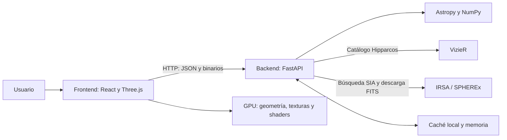
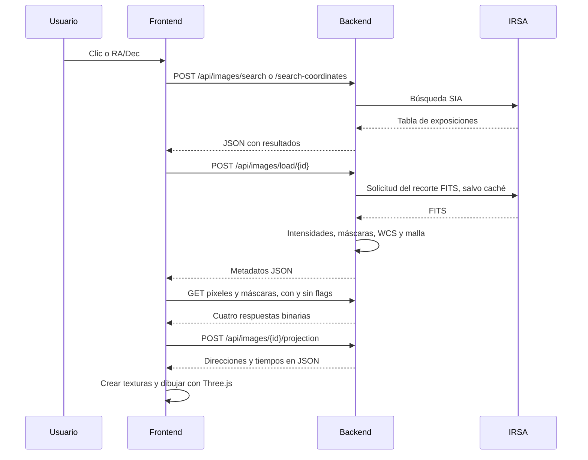

# Documentación técnica y guía de interpretación del Proyecto Prototipo

**Proyecto:** `sandbox/Charlie Kirk/Proyecto_Prototipo`

**Fecha de revisión:** 14 de noviembre de 2026

**Audiencia:** equipo de desarrollo y participantes que necesitan entender los datos, la interfaz y el flujo científico del prototipo.

> Este documento describe la implementación revisada, incluyendo búsqueda manual por RA/Dec, ubicación manual y reintentos de descarga. Distingue las funciones existentes de las mejoras pendientes. Los ejemplos de matrices, coordenadas y respuestas son ilustrativos; no constituyen mediciones astronómicas verificadas.

## Índice

1. [Contexto y propósito](#1-contexto-y-propósito)
2. [Conceptos necesarios para interpretar el proyecto](#2-conceptos-necesarios-para-interpretar-el-proyecto)
3. [Arquitectura y estructura de archivos](#3-arquitectura-y-estructura-de-archivos)
4. [Flujo completo al escoger una zona](#4-flujo-completo-al-escoger-una-zona)
5. [Cómo se transportan las matrices del backend al frontend](#5-cómo-se-transportan-las-matrices-del-backend-al-frontend)
6. [Cómo se dibujan los datos en la GPU](#6-cómo-se-dibujan-los-datos-en-la-gpu)
7. [Guía completa del panel derecho](#7-guía-completa-del-panel-derecho)
8. [Tiempo, ubicación y horizonte](#8-tiempo-ubicación-y-horizonte)
9. [SPHEREx: QR3, DR1 y QR2](#9-spherex-qr3-dr1-y-qr2)
10. [Especificaciones y límites actuales](#10-especificaciones-y-límites-actuales)
11. [Datos importantes para desarrollar e interpretar el proyecto](#11-datos-importantes-para-desarrollar-e-interpretar-el-proyecto)
12. [Errores, caché y recuperación](#12-errores-caché-y-recuperación)
13. [Ejemplo completo de uso](#13-ejemplo-completo-de-uso)
14. [Referencia de endpoints](#14-referencia-de-endpoints)
15. [Ejecución y verificación](#15-ejecución-y-verificación)
16. [Mejoras pendientes identificadas](#16-mejoras-pendientes-identificadas)
17. [Glosario](#17-glosario)
18. [Fuentes y referencias](#18-fuentes-y-referencias)

## 1. Contexto y propósito

El prototipo es un explorador astronómico web. Muestra estrellas en un cielo tridimensional calculado para un observador terrestre y permite consultar imágenes espectrales de SPHEREx alojadas en IRSA. Las imágenes se posicionan sobre ese cielo mediante su información astrométrica WCS.

Integra dos fuentes de datos diferentes:

- **Hipparcos, obtenido mediante VizieR:** posiciones, movimientos propios, magnitudes y colores aproximados de estrellas. Sirve como contexto de navegación del cielo.
- **SPHEREx, obtenido mediante IRSA:** exposiciones infrarrojas en archivos FITS, con intensidades y metadatos instrumentales. Sirve para explorar observaciones de una región.

Las estrellas dibujadas no son una extracción de fuentes realizada sobre el FITS seleccionado. Tampoco el brillo de una estrella del catálogo es automáticamente una medición de su flujo en la imagen SPHEREx.

La aplicación permite inspección y comparación visual. No implementa por sí sola una reducción científica completa, una medición fotométrica con incertidumbre ni una confirmación automática de variabilidad.

## 2. Conceptos necesarios para interpretar el proyecto

### 2.1 Tres espacios de coordenadas

| Espacio | Datos | Para qué sirve |
|---|---|---|
| Terrestre | Latitud, longitud y elevación | Define desde dónde se observa el cielo. |
| Celeste ICRS | Ascensión recta y declinación: RA/Dec | Identifica una dirección astronómica independiente de la orientación local de la cámara. |
| Local AltAz / escena 3D | Altitud, azimut y vector `(x, y, z)` | Sitúa estrellas e imágenes respecto al horizonte del observador en un instante. |

**RA/Dec no sustituye la ubicación terrestre.** Con RA/Dec se puede buscar y descargar una imagen sin geolocalización; para colocarla sobre el horizonte local se necesita latitud, longitud, elevación y tiempo.

- RA en este formulario se expresa en **grados decimales**, con `0 ≤ RA < 360`.
- Dec se expresa en grados decimales, entre `−90` y `+90`.
- Si se dispone de RA en horas, la conversión es `grados = horas × 15`; no se debe pegar un valor en horas como si fueran grados.
- `1 grado = 60 minutos de arco`; `1 arcmin = 60 segundos de arco`.

### 2.2 FITS, HDU y WCS

Un FITS puede contener múltiples extensiones o **HDU**. No equivale a una fotografía PNG: puede incluir una matriz de intensidades, banderas de calidad, calibraciones y tablas de coordenadas.

En este proyecto:

- Se utiliza la extensión `IMAGE` si está disponible; si no, se busca una imagen bidimensional.
- `FLAGS` permite reconocer píxeles con problemas de calidad.
- `BUNIT` informa las unidades de la imagen. El código conserva ese texto; no debe suponerse una unidad universal para todos los archivos.
- `DATE-OBS` informa la fecha de adquisición.
- **WCS** permite pasar de píxel a coordenada celeste y viceversa, incluyendo la distorsión soportada por Astropy.
- `WCS-WAVE`, cuando está presente y es compatible, se utiliza para una estimación espectral en el punto de búsqueda.

### 2.3 Detector, canal y longitud de onda

SPHEREx utiliza seis detectores para cubrir aproximadamente `0.75–5.0 µm`. El filtro de longitud de onda variable hace que distintos puntos de una exposición correspondan a distintas longitudes de onda.

Por tanto:

1. Una imagen de un detector no representa las 102 bandas medidas de manera independiente en cada píxel.
2. El intervalo espectral de la exposición no es necesariamente la banda exacta del objeto seleccionado.
3. Para comparar observaciones hay que considerar la longitud de onda **en el mismo punto del cielo**, no solo el nombre del detector.

## 3. Arquitectura y estructura de archivos

### 3.1 Responsabilidades



- **Backend:** valida solicitudes, consulta archivos externos, interpreta FITS, transforma coordenadas y prepara matrices numéricas.
- **Frontend:** gestiona formularios, peticiones y estados; interpreta los formatos recibidos; crea recursos de Three.js y controles visuales.
- **GPU:** interpola geometría y convierte intensidades en colores durante el renderizado.

La aplicación usa HTTP y `fetch`; no utiliza un flujo continuo por WebSocket para enviar cada fotograma.

### 3.2 Estructura relevante

```text
NSAC-Playground/
├── readme.md
├── data/                       # Datos pequeños compartidos del repositorio
├── shared/                     # Guías y recursos comunes
└── sandbox/
    └── Charlie Kirk/
        ├── copiaImportante.md  # Instrucciones originales de ejecución
        ├── Documentacion_tecnica_Proyecto_Prototipo.md
        └── Proyecto_Prototipo/
            ├── frontend/
            │   ├── package.json
            │   ├── vite.config.js
            │   ├── tests/
            │   └── src/
            │       ├── App.jsx
            │       ├── components/
            │       │   ├── FitsPanel.jsx
            │       │   ├── CoordinateSearch.jsx
            │       │   ├── LocationControls.jsx
            │       │   ├── SpectralCoverage.jsx
            │       │   ├── FitsComparisonPanel.jsx
            │       │   ├── SkyTimePanel.jsx
            │       │   ├── StarAppearanceControls.jsx
            │       │   ├── camera/
            │       │   └── scene/
            │       ├── hooks/
            │       └── utils/
            └── python/
                ├── main.py
                ├── requirements.txt
                ├── tests/
                ├── jupyter/    # Experimentos y notebooks
                ├── data/       # Caché generada al ejecutar; no es data/ de la raíz
                └── src/
                    ├── models.py
                    ├── astronomy/
                    │   ├── catalog.py
                    │   ├── sky.py
                    │   └── transport.py
                    └── images/
                        ├── routes.py
                        ├── irsa.py
                        ├── layers.py
                        ├── footprint.py
                        ├── spectral.py
                        └── detectors.py
```

Los entornos `venv`/`.venv`, `node_modules`, archivos de caché y compilaciones son recursos locales; no deben confundirse con módulos fuente.

### 3.3 Mapa de archivos y funciones

Las rutas de esta tabla parten de `Proyecto_Prototipo/`.

| Archivo o grupo | Responsabilidad |
|---|---|
| `python/main.py` | Aplicación FastAPI, CORS, compresión y endpoints del cielo. |
| `python/src/astronomy/catalog.py` | Descarga, análisis, ordenamiento y caché de Hipparcos. |
| `python/src/astronomy/sky.py` | Movimiento propio, transformación ICRS a AltAz y muestras temporales. |
| `python/src/astronomy/transport.py` | Construcción del paquete binario `SKY1`. |
| `python/src/images/routes.py` | Modelos y endpoints de búsqueda, carga, píxeles, máscaras y proyección. |
| `python/src/images/irsa.py` | Consulta SIA, candidatos, descarga con reintentos y caché en disco. |
| `python/src/images/layers.py` | Lectura FITS, calidad, reducción de resolución, malla WCS y proyección. |
| `python/src/images/spectral.py` | Estimación de longitud de onda y ancho de banda en el punto seleccionado. |
| `frontend/src/App.jsx` | Conecta ubicación, reloj, estrellas, búsqueda, imágenes y comparación. |
| `frontend/src/hooks/useAutomaticObserver.js` | Geolocalización, timeout, reintento y observador manual. |
| `frontend/src/hooks/useStars.js` | Solicitudes y renovación del cielo. |
| `frontend/src/hooks/useFitsImage.js` | Búsqueda, primera descarga, selección de imagen y cancelación. |
| `frontend/src/hooks/useImageProjection.js` | Obtiene la posición temporal de una imagen para el observador. |
| `frontend/src/hooks/useFitsComparison.js` | Carga de B, filtros y reproducción A/B. |
| `frontend/src/utils/stars.js` y `skyTransport.js` | Solicitud y decodificación del cielo binario. |
| `frontend/src/utils/imageApi.js` | Cliente HTTP de imágenes, decodificación binaria y validaciones. |
| `frontend/src/components/scene/FitsOverlay.jsx` | Texturas, geometría y shaders de la imagen. |
| `frontend/src/components/FitsPanel.jsx` | Panel derecho y organización de controles. |

## 4. Flujo completo al escoger una zona

### 4.1 Entrada por clic sobre el cielo

1. El navegador obtiene una ubicación o el usuario introduce una manual.
2. El reloj determina el instante de visualización.
3. La cámara entrega la dirección tridimensional del clic.
4. `App.jsx` envía `direction`, `observer`, `at`, tamaño, colección y detector a `/api/images/search`.
5. `click_to_icrs()` normaliza el vector y reconstruye azimut y altitud.
6. Astropy transforma esa dirección local a RA/Dec ICRS.
7. El backend consulta IRSA con esa posición.

La convención de la escena es `+X = este`, `+Y = arriba`, `−Z = norte`. Para un vector unitario:

```text
altitud = asin(y)
azimut  = atan2(x, -z)
```

### 4.2 Entrada directa por RA/Dec

El formulario envía una solicitud a `/api/images/search-coordinates`:

```json
{
  "ra_deg": 10.6847,
  "dec_deg": 41.269,
  "size_arcmin": 30,
  "collection": "spherex_qr3",
  "detector": null
}
```

No incluye observador ni fecha porque ya proporciona la dirección celeste. La disponibilidad de exposiciones sigue dependiendo del archivo remoto; esas coordenadas no garantizan un resultado.

### 4.3 Descubrimiento de exposiciones

`search_images()` consulta `https://irsa.ipac.caltech.edu/SIA`. Utiliza una búsqueda pequeña alrededor de la posición (`CIRCLE ... 0.00001`, en grados) para localizar exposiciones que contienen el punto. **No realiza un mosaico de todas las imágenes que cubran el ancho solicitado.**

El tamaño de campo se usa posteriormente al solicitar el recorte de la exposición elegida. Se piden hasta 24 registros. Si el resultado puede estar truncado, la interfaz lo indica.

Cuando se selecciona un detector, la consulta utiliza un filtro espectral y posteriormente verifica el detector obtenido de la ruta del archivo. El resultado contiene identificador, fecha, detector, intervalo de longitud de onda y URL de origen.

El identificador es un hash de la URL, posición, tamaño y versión del procesamiento local. No es un identificador universal de la exposición: cambiar la posición o el tamaño puede producir otro identificador para el mismo FITS de origen.

### 4.4 Descarga y preparación



El hook descarga automáticamente la **primera exposición** encontrada. Esto es una regla de la interfaz; no demuestra que sea la más reciente, la mejor calibrada o la de mayor calidad. El usuario puede escoger otra en `Matching observations`.

## 5. Cómo se transportan las matrices del backend al frontend

### 5.1 Idea central: hay tres flujos diferentes

| Flujo | Representación en Python | Transporte HTTP | Representación en JavaScript |
|---|---|---|---|
| Estrellas | Direcciones NumPy y metadatos | `SKY1`: cabecera JSON + `float32` binarios | `Float32Array` y metadatos del catálogo |
| Intensidad FITS y calidad | Matrices 2D NumPy | `application/octet-stream` | `Float32Array` y `Uint8Array` |
| Malla y proyección FITS | UV, índices y direcciones | JSON | Arrays; después `Float32Array` y `Uint32Array` para la GPU |

No se envía un PNG como representación principal de las intensidades. El navegador recibe números y aplica la visualización.

### 5.2 Matriz FITS: de la imagen original a una previsualización

`prepare_layer()` abre el FITS con Astropy y obtiene una matriz con forma:

```text
data.shape = (alto, ancho)
data[fila, columna] = intensidad científica de ese píxel
```

Ejemplo didáctico:

```text
data = [[10, 20, 30],
        [40, 50, 60]]

alto = 2; ancho = 3
```

La imagen se convierte a `float32`. Si es demasiado grande para la textura de visualización, se calcula:

```text
factor = max(1, ceil(max(alto_original, ancho_original) / 1024))
alto_preview  = alto_original // factor
ancho_preview = ancho_original // factor
```

Se recortan las filas o columnas sobrantes necesarias para agrupar bloques completos. Dentro de cada bloque se promedian **solo las muestras incluidas por la máscara correspondiente**. Un bloque sin muestras válidas queda con intensidad de almacenamiento cero y máscara cero, por lo que no se muestra.

Por ejemplo, en un bloque `[[10, 20], [30, 1000]]`, si `1000` está marcado como defectuoso:

- Promedio sin flags, si todos son finitos: `265`.
- Promedio con flags: `(10 + 20 + 30) / 3 = 20`.

Ocultar el bloque después de promediar no eliminaría la contaminación del valor `1000`. Por eso se preparan **dos matrices de intensidad**, no solo dos máscaras sobre una misma media.

La previsualización es un promedio por bloques, no una copia a resolución nativa ni una suma de flujo. El FITS original permanece como referencia científica.

### 5.3 Las cuatro matrices enviadas

| Endpoint | Matriz | Tipo y significado |
|---|---|---|
| `GET /api/images/{id}/pixels` | Intensidad filtrada | `float32` little-endian; promedio de muestras que pasan calidad. |
| `GET /api/images/{id}/mask` | Cobertura filtrada | `uint8`; `255` si el bloque contiene al menos una muestra válida, `0` si no. |
| `GET /api/images/{id}/pixels?apply_quality_flags=false` | Intensidad sin filtrar por flags | `float32`; promedio de muestras finitas. |
| `GET /api/images/{id}/mask?apply_quality_flags=false` | Cobertura finita | `uint8`; distingue bloques con datos finitos de bloques vacíos. |

Los endpoints usan calidad activada por defecto, pero la interfaz inicialmente muestra la versión **sin flags**, porque `applyQualityFlags` empieza en `false`.

Las cuatro respuestas se solicitan en paralelo mediante `Promise.all()`. Después, cambiar `Apply quality flags` selecciona las texturas ya descargadas; no requiere otra descarga.

### 5.4 Aplanamiento, orden y endianness

Python serializa las matrices con `tobytes(order="C")`: las columnas de una fila se almacenan consecutivamente y luego sigue la siguiente fila.

```text
[[10, 20, 30], [40, 50, 60]]
                  ↓
[10, 20, 30, 40, 50, 60]

índice = fila × ancho + columna
```

Cada `float32` ocupa 4 bytes. Para la matriz de ejemplo:

- Intensidad: `2 × 3 × 4 = 24 bytes`.
- Máscara: `2 × 3 × 1 = 6 bytes`.
- Las dos intensidades y las dos máscaras: `60 bytes` sin contar metadatos ni cabeceras HTTP.

Una textura de `1024 × 1024` requiere aproximadamente `10 MiB` de datos numéricos para las cuatro matrices: dos intensidades de `4 MiB` y dos máscaras de `1 MiB`. En el navegador y GPU puede haber copias y recursos adicionales; no es una estimación de memoria total.

`little-endian` especifica el orden de los bytes dentro de cada número. El frontend no asume el orden nativo de la máquina al decodificar intensidades FITS:

```javascript
const view = new DataView(buffer);
const values = new Float32Array(count);
for (let i = 0; i < count; i += 1) {
    values[i] = view.getFloat32(i * 4, true); // true: little-endian
}
const value = values[row * width + column];
```

Antes de aceptar los datos, `loadImagePixels()` verifica que cada intensidad mida exactamente `ancho × alto × 4` bytes y cada máscara `ancho × alto` bytes.

### 5.5 Metadatos de la imagen: el contrato JSON

La respuesta de `/load/{id}` no contiene todas las matrices de intensidad. Contiene cómo interpretarlas y cómo colocarlas:

| Grupo | Campos principales |
|---|---|
| Identidad | `id`, `source`, `source_url` |
| Dimensiones | `width`, `height`, `native_width`, `native_height`, `bin_factor` |
| Observación | `units`, `observation_time`, `detector` |
| Espectro en el punto | `target_spectrum`: posición, centro, ancho, fuente y carácter aproximado |
| Posición | `frame`, `center_ra_deg`, `center_dec_deg`, `angular_radius_deg` |
| Huella | `angular_width_arcmin`, `angular_height_arcmin` |
| Malla | `uv`, `indices`, `mesh_segments`, `mesh_error_pixels` |
| Escala visual | `stretch_min`, `stretch_max` |
| Calidad | `valid_fraction`, `finite_fraction`, `rejected_flags` |
| Recursos | `pixels_url`, `mask_url` |

`native_width` y `native_height` describen el FITS recibido, que puede ser un recorte remoto; no necesariamente describen la exposición completa original del instrumento.

### 5.6 Malla WCS y matrices de proyección

No basta pegar una imagen como rectángulo en una esfera: la proyección y distorsión WCS pueden curvar sus bordes.

`build_mesh()` crea una cuadrícula de vértices y triángulos. Para cada vértice:

1. Asigna coordenadas de textura `(u, v)` entre 0 y 1.
2. Convierte su ubicación en píxeles a coordenadas celestes mediante WCS.
3. Refina la cuadrícula hasta que la interpolación de triángulos cumple el error objetivo de `0.15` píxel nativo, o rechaza la imagen si supera el límite soportado.

Los niveles de refinamiento probados son `8`, `16`, `32`, `64` y `128` segmentos por lado. Se emplea `−0.5` al transformar bordes de píxel porque Astropy representa los centros de píxel en coordenadas enteras. Esto evita un desplazamiento artificial de medio píxel.

Para un observador e instante, `/projection` devuelve:

```text
sample_times_ms:  [t0, t1, ..., t(T-1)]
directions:      T filas de V × 3 valores
center_directions: T filas de 3 valores
```

`T` es el número de instantes y `V` el número de vértices. En cada fila, los valores están ordenados `[x0,y0,z0,x1,y1,z1,...]`. Estas direcciones se envían en **JSON**, no dentro del paquete `SKY1`.

### 5.7 Estrellas: catálogo estático y paquete SKY1

El catálogo Hipparcos conserva coordenadas ICRS en época de referencia `J1991.25`. El backend propaga el movimiento propio angular disponible y calcula direcciones locales. El catálogo se ordena por magnitud y luego por identificador HIP.

El navegador obtiene `/api/star-catalog` una vez por caché del módulo. Contiene identificadores, nombres de catálogo, magnitudes y colores. Los nombres pueden ser `HIP n`; no todos son nombres tradicionales.

Para actualizar posiciones, el frontend solicita `/api/sky` con `format: "binary"`, límite de magnitud y versión del catálogo. El paquete es:

```text
Offset  Tamaño        Contenido
0       4 bytes       Firma ASCII: SKY1
4       4 bytes       Longitud H de cabecera: uint32 little-endian
8       H bytes       JSON UTF-8, con espacios de relleno hasta múltiplo de 4
8 + H   T × N × 3 × 4 Direcciones float32 little-endian
```

La cabecera incluye tiempos, número de estrellas, versión, límite de magnitud, marco, observador y otra información del cálculo. Excluye la matriz `directions`, que va al final en binario. El tipo HTTP es `application/vnd.astronomy.sky+octet-stream`.

Ejemplo de dos estrellas y dos instantes:

```text
Forma conceptual: (T=2, N=2, componentes=3)

t0: [x_A, y_A, z_A, x_B, y_B, z_B]
t1: [x_A, y_A, z_A, x_B, y_B, z_B]

Parte numérica: 2 × 2 × 3 × 4 = 48 bytes
Tamaño del paquete: 8 + H + 48 bytes
```

`decodeSky()` comprueba firma, longitud, alineación, versión y dimensiones. En máquinas little-endian crea una vista `Float32Array` sobre el buffer, evitando una copia adicional para la decodificación. Luego separa los instantes con `subarray()`.

El orden de estrellas debe coincidir con el catálogo. La selección por magnitud es un prefijo de ese mismo orden. La versión impide asociar direcciones nuevas con identificadores de un catálogo diferente; ante `409`, el cliente vuelve a obtener el catálogo y repite una vez.

### 5.8 Muestreo temporal e interpolación

En modo en vivo, el backend genera 13 muestras: desde el instante solicitado hasta 120 segundos después, separadas por 10 segundos. En pausa devuelve una sola muestra.

Para un tiempo entre dos muestras:

```text
mezcla = (tiempo_actual − t_i) / (t_(i+1) − t_i)
dirección_visual = normalizar((1 − mezcla) × dirección_i + mezcla × dirección_(i+1))
```

Los hooks renuevan normalmente las posiciones cada 45 segundos; tras un error, programan el siguiente intento en 10 segundos en modo en vivo. No se consulta al backend cada fotograma.

Si ya no hay una muestra temporal válida, el sistema evita presentar esa posición como vigente. Para imágenes, la malla se oculta cuando no existe una ventana válida. Al cambiar observador o reloj se solicita la proyección correspondiente.

## 6. Cómo se dibujan los datos en la GPU

`FitsOverlay.jsx` crea texturas `DataTexture` de Three.js:

- Intensidades: `RedFormat` y `FloatType`.
- Máscaras: `RedFormat` y `UnsignedByteType`.
- Paleta: textura RGBA utilizada como tabla de consulta de color.

Las intensidades no son ya valores RGB. El shader convierte cada intensidad a un brillo visual:

1. Descarta píxeles cuya máscara indique ausencia de datos.
2. Descarta posiciones debajo del horizonte si esa opción está desactivada.
3. Normaliza por `stretch_min` y `stretch_max`.
4. Multiplica por `2^exposure`, donde `exposure` proviene del control de brillo.
5. Aplica un estiramiento tipo `asinh` para representar un rango dinámico amplio.
6. Utiliza una paleta de falso color o escala de grises y aplica opacidad.

El backend calcula inicialmente la escala visual con percentiles `1` y `99.5` de los valores de previsualización incluidos por calidad, o de los finitos si no quedan valores filtrados. Se comparte esta escala al alternar flags para evitar que cambie el contraste solo por cambiar el filtro.

Los datos usan `NearestFilter` para el muestreo de intensidades y máscaras. `flipY = false` conserva la convención elegida: fila cero del FITS y `v = 0` corresponden al borde inferior. La orientación depende de WCS, UV y orden de filas conjuntamente; invertir una sola parte produciría una imagen mal alineada.

La imagen se dibuja a un radio de escena de `920`. Ese número es una escala de renderizado, **no la distancia física al objeto**. La cámara está en el origen y las direcciones indican posición angular.

Cambiar brillo, opacidad o paleta no reescribe el FITS ni convierte una intensidad a otra unidad científica.

## 7. Guía completa del panel derecho

El elemento que aparece a la derecha es el panel lateral **FITS image explorer**, no una ventana de adquisición de datos independiente. Agrupa controles de ubicación, búsqueda, exposición, comparación y presentación. Algunas secciones aparecen solo cuando hay una búsqueda o imagen cargada.

### 7.1 Encabezado y estados generales

| Elemento | Explicación |
|---|---|
| `FITS image explorer` / `SPHEREx` | Identifica el explorador; el encabezado permite plegar el contenido. |
| `Locating…` | El navegador está buscando la ubicación; hay un límite independiente de 12 segundos. |
| `Loading sky…` | Se calculan o descargan posiciones de estrellas. No equivale a descargar el FITS. |
| `Loading fainter stars…` | Se amplía la profundidad del catálogo al hacer zoom. |
| `Retry` / `Refresh sky` | Reintenta el cálculo o actualiza muestras del cielo. |
| `Finding ... exposures` | Se consulta el archivo para encontrar exposiciones. |
| `Downloading ... FITS cutout` | Se descarga y prepara el recorte seleccionado. |
| `Cancel loading` | Aborta la petición del navegador y actualiza su estado. No garantiza detener de inmediato el trabajo síncrono que ya ejecuta el backend. |
| Mensaje de error | Debe interpretarse según la fase: ubicación, catálogo, búsqueda, descarga o proyección. |

### 7.2 Ubicación del observador

| Campo o control | Significado y límites |
|---|---|
| `Device location` / `Manual location` | Fuente y coordenadas terrestres activas. |
| `Retry device location` | Nueva solicitud al navegador sin recargar; se desactiva mientras está pendiente. |
| `Enter observer location manually` | Abre el formulario; aparece desplegado si termina la espera sin observador. |
| `Latitude (°)` | Latitud geográfica: `−90` a `90`. |
| `Longitude (°)` | Longitud geográfica: `−180` a `180`. |
| `Elevation (m)` | Altura para el cálculo: `−500` a `10000` metros; valor inicial manual `0`. |
| `Use manual location` | Valida y activa el observador; invalida respuestas automáticas pendientes para que no lo sobrescriban. |

La geolocalización depende del navegador y del sistema operativo, no de IRSA. Si no se obtiene altura finita del dispositivo, se utiliza `0 m`. La posición puede ser aproximada; la interfaz no presenta un análisis de precisión de esa ubicación.

### 7.3 Búsqueda de archivo

| Campo o control | Qué cambia |
|---|---|
| `Click sky to load` | Activa búsquedas al hacer clic; requiere observador. Arrastrar sigue sirviendo para navegar. |
| `Field width (arcmin)` | Tamaño solicitado del recorte, no el campo de visión de la cámara. Rango `1–240 arcmin`; por defecto `210 arcmin` (`3.5°`). |
| `Release` | Colección consultada: actualmente `SPHEREx QR3` o `SPHEREx QR2`; QR3 es el valor inicial. Véase la sección de releases antes de usar QR2. |
| `Detector` | `All detectors` o uno de los seis detectores; limita la búsqueda. |
| `Search by RA / Dec` | Búsqueda ICRS manual, disponible sin ubicación terrestre. Se abre automáticamente tras fallar la ubicación. |
| `RA (°)` / `Dec (°)` | Grados decimales, con los límites descritos en la sección 2. |
| `Search coordinates` | Ejecuta la búsqueda con el tamaño, colección y detector actuales. |

Cambiar filtros no vuelve a buscar inmediatamente: se debe pulsar el botón de coordenadas o realizar un nuevo clic. El recorte final puede quedar limitado por el borde de la exposición y no cubrir exactamente el tamaño solicitado.

#### Detectores mostrados en el selector

| Detector | Rango nominal mostrado |
|---|---|
| D1 | `0.75–1.09 µm` |
| D2 | `1.10–1.62 µm` |
| D3 | `1.63–2.41 µm` |
| D4 | `2.42–3.82 µm` |
| D5 | `3.83–4.41 µm` |
| D6 | `4.42–5.00 µm` |

Estos rangos orientan la búsqueda; no sustituyen la calibración por píxel. Los bordes usados para dibujar los canales nominales de diseño difieren ligeramente de estos intervalos. Son convenciones distintas que el código mantiene separadas.

### 7.4 Search position y selección de observaciones

| Elemento | Cómo interpretarlo |
|---|---|
| `ICRS RA ... · Dec ...` | Posición celeste utilizada en la búsqueda. Los decimales mostrados no garantizan esa exactitud instrumental. |
| `Search filter` | Detector usado en esa búsqueda, no necesariamente el valor que se está editando para la próxima. |
| `Matching observations` | Exposiciones encontradas. Cada opción muestra detector, fecha/hora y rango espectral si existe. Elegir otra inicia su carga. |
| `No ... matches found` | La consulta no devolvió candidatos para esos criterios. No significa que el cielo carezca de fuentes. |
| `... observations` | Cantidad recibida, no necesariamente el total histórico del archivo. |
| `limited results` | La lista puede estar truncada por el máximo de resultados solicitado. |

La fecha de una opción proviene de metadatos de la búsqueda; la fecha de la imagen cargada se lee del FITS. Conviene conservar ambas procedencias para auditoría.

### 7.5 Exposure coverage: franja de 102 canales

La franja dibuja 102 intervalos nominales entre `0.75` y `5 µm`, 17 por detector. El eje es lineal en longitud de onda, de modo que intervalos físicamente mayores ocupan más anchura. Los límites internos nominales se construyen con progresión geométrica.

- D1–D6 identifican las seis bandas de diseño.
- El resaltado marca el solapamiento con `wavelength_min_um` y `wavelength_max_um` de la exposición seleccionada.
- Al pasar el cursor por un canal se muestra su número, detector e intervalo nominal.
- `Wavelength range unavailable` indica ausencia de metadatos suficientes.
- La leyenda `Nominal channels · full exposure, not individual pixels` es esencial: el resaltado **no indica que cada píxel contenga todo ese espectro**.

### 7.6 Loaded image / Reference image A

| Dato o control | Significado |
|---|---|
| `Loaded image` | Imagen activa sin comparación. |
| `Reference image · A` | La misma imagen actúa como referencia cuando hay B. |
| `WCS POSITIONED` | Existe una muestra de proyección válida para el tiempo de visualización. No certifica exactitud fotométrica ni calidad del FITS. |
| `WAITING` | La imagen puede estar descargada, pero aún no tiene proyección temporal válida para dibujarla. |
| `IRSA · spherex_qr3` u otra fuente | Archivo y colección de procedencia. |
| `D1`–`D6` / `Unknown detector` | Detector leído de la cabecera; si no es reconocible se indica desconocido. |
| `% source pixels included` | Proporción de píxeles fuente incluidos en el área utilizada para la previsualización. Con flags usa `valid_fraction`; sin flags usa `finite_fraction`. No es un porcentaje de probabilidad, cobertura total del cielo ni precisión. |
| `Observed: ... UTC` | Fecha de adquisición de la exposición. No cambia al modificar el reloj del cielo. |
| `ancho × alto px` | Dimensiones de la previsualización entregada al frontend, no necesariamente las nativas. |
| Unidades junto a las dimensiones | Texto de `BUNIT`; si falta, `unknown`. |
| `Sky footprint` | Anchura y altura angulares medidas con WCS entre puntos medios de bordes opuestos. No equivale a un área exacta de un rectángulo plano. |
| `requested ...` | El componente puede mostrar el tamaño solicitado si recibe `requested_size_arcmin`. Actualmente `prepare_layer()` no incluye ese campo, por lo que esa anotación no está garantizada. |
| `Center image` | Orienta la cámara hacia el centro de la imagen y ajusta el zoom. No cambia su astrometría. |
| `Remove image` | Retira la imagen de la interfaz; no implica borrar el FITS de la caché del backend. |
| `Below horizon` / `Show below horizon` | Advierte que el centro está bajo el horizonte y permite mostrar esa región. |
| `Updating image directions…` | Se calcula una nueva proyección local. |
| `Retry positioning` | Repite la solicitud de proyección, no necesariamente la descarga FITS. |

El porcentaje se calcula antes del promedio de bloques. En cambio, una máscara de previsualización indica si **un bloque** contiene al menos una muestra incluida. Por ello no debe interpretarse ese porcentaje como porcentaje exacto de texeles visibles.

### 7.7 Calidad y representación visual

| Control | Efecto real |
|---|---|
| `Apply quality flags` | Selecciona promedios y máscaras calculados excluyendo muestras marcadas como defectuosas. Inicialmente desactivado. |
| `Quality flags ignored` | No se excluyen muestras solo por flags; valores no finitos siguen ocultos. |
| `RGB intensity palette` | Falso color que representa intensidad: no es una combinación de tres bandas RGB físicas. |
| `Grayscale` | Mapea intensidad a gris. |
| Leyenda `Faint`–`Bright` | Orienta sobre la escala visual, no es una barra de flujo con unidades calibradas. |
| `Opacity` | Transparencia: `0–100 %`, inicial `90 %`. |
| `Brightness` | Escala visual de `−3` a `+3` pasos, inicial `0`; cada paso multiplica por 2 antes del estiramiento. |
| `Original FITS` | Abre `source_url`, la URL de origen de la exposición. No debe asumirse que devuelve el mismo recorte procesado que el visor ni las matrices de previsualización. |

La máscara usa definiciones `MP_*` de la cabecera cuando existen; si faltan, aplica una lista de bits SPHEREx implementada en `layers.py`. Se excluyen condiciones como datos ausentes, píxeles calientes/fríos y otros artefactos definidos allí. `SOURCE` y `FULLSAMPLE` se tratan como informativas, no como motivos de rechazo. Si no existe una extensión `FLAGS` compatible en forma con la imagen, la máscara queda basada en finitud; activar el control no crea información de calidad ausente.

### 7.8 Compare observations: comparación A/B

La sección aparece cuando A pertenece a la lista de resultados de la búsqueda actual. No ejecuta automáticamente una consulta de toda la historia del objeto.

| Control o dato | Interpretación |
|---|---|
| A: fecha y detector | Referencia cargada. |
| `1 · Dates only` | Candidatos con fecha válida distinta de A, sin exigir mismo detector. |
| `2 · Same detector` | Añade el requisito de mismo detector. |
| `3 · Similar wavelength` | También exige detector común y comprueba similitud espectral en el punto cuando B termina de cargar. |
| `B from (UTC)` / `B through (UTC)` | Fechas que filtran la lista; el día final se incluye completo. No vuelven a consultar IRSA. |
| `Observation B` | Selección de una segunda exposición de los resultados ya recibidos. |
| `... candidates in these search results` | Número de candidatos locales tras aplicar filtros; no total de todas las observaciones existentes. |
| `Band tolerance` | Tolerancia de `¼`, `½` o `1` vez el ancho de banda más estrecho; inicial `½`. |
| `Loading B…` / `Cancel` | Descarga y cancelación de la segunda imagen. |
| `At clicked point: A/B` | Centro espectral y ancho estimados en µm en el punto de búsqueda. También aplica si el punto se introdujo por RA/Dec. |
| `These images use different brightness units` | Las cadenas de unidades no coinciden; no se genera escala compartida. |
| `Positioning both images…` | Se espera una proyección válida de ambas antes de alternarlas. |
| `Show A` / `Show B` | Muestra una de las imágenes. |
| `Blink` / `Pause` | Alterna imágenes para inspección visual. |
| `Blink interval` | Tiempo entre alternancias: `0.5–3 s`, inicial `1 s`. |
| `Showing A/B` | Identifica la imagen y fecha visibles. |
| `Clear comparison` | Elimina B de la comparación, conservando A. |

La regla espectral es una heurística del visor:

```text
|centro_A − centro_B| ≤ tolerancia × min(ancho_A, ancho_B)
```

Se exige que las estimaciones refieran al mismo punto del cielo. `target_spectrum` consulta la WCS espectral alternativa y no inventa un valor a partir del rango global del detector si falla.

La escala visual compartida usa el menor límite inferior y el mayor límite superior de A y B, siempre que sus unidades sean iguales. La alineación es mediante coordenadas celestes; no se realiza una resta científica de imágenes ni una homogeneización automática de PSF.

**Una diferencia al parpadear no confirma un cambio real.** Puede deberse a banda, PSF, ruido, calibración, flags, recorte o cobertura. La banda aproximada en un punto tampoco garantiza equivalencia espectral en toda la imagen.

### 7.9 Star appearance y horizonte

| Control | Significado |
|---|---|
| `Star size` | Tamaño gráfico relativo: `50–300 %`, inicial `100 %`. No mide diámetro estelar. |
| `Glow strength` | Intensidad del halo gráfico: `0–300 %`, inicial `100 %`; no modifica el FITS. |
| `Reset star appearance` | Recupera valores de presentación iniciales. |
| `Show below horizon` | Permite dibujar estrellas e imágenes con altitud negativa; no hace esos objetos físicamente observables desde el lugar. |

## 8. Tiempo, ubicación y horizonte

### 8.1 Dos tiempos diferentes

- **Tiempo de observación:** cuándo SPHEREx adquirió el FITS. Forma parte del dato.
- **Tiempo de visualización:** cuándo y desde dónde se quiere representar la dirección del objeto en el cielo local.

Cambiar `Sky time` no busca automáticamente una exposición tomada en esa fecha. Cambia las transformaciones locales y las posiciones mostradas.

El panel izquierdo muestra hora local y UTC. `Now` activa el modo en vivo; `Pause` fija el instante; `Set time` acepta fecha y hora explícitamente en UTC.

### 8.2 Qué ocurre si falla la ubicación

| Operación | ¿Necesita ubicación terrestre? |
|---|---|
| Buscar por clic sobre el cielo local | Sí. |
| Buscar por RA/Dec | No. |
| Descargar un candidato ya registrado y sus píxeles | No. |
| Abrir la URL original del FITS | No. |
| Proyectar imágenes y estrellas respecto al horizonte | Sí, automática o manual. |
| Alternar A/B sobre el cielo con las garantías de posicionamiento de la interfaz | Sí. |

La API de geolocalización requiere contexto seguro: HTTPS o una excepción de desarrollo como `localhost`. Abrir la aplicación mediante una IP de red por HTTP puede impedirla. También influyen permisos del sitio, configuración de ubicación de Windows y disponibilidad del proveedor de posición.

El código solicita precisión no alta, acepta una posición de hasta 60 segundos de antigüedad y aplica 12 segundos de espera. Hay además un temporizador propio porque la espera de permiso no siempre queda cubierta por el timeout del navegador.

### 8.3 Alcance del modelo del cielo

La conversión usa datos IERS de orientación terrestre y `AltAz` sin refracción (`pressure = 0`). No se extrapola silenciosamente fuera del rango de fechas admitido por esos datos.

El modelo declara estas limitaciones: sin refracción atmosférica, sin paralaje estelar, sin relieve real del horizonte y sin modelo de visibilidad por luz diurna. La visibilidad de estrellas al hacer zoom es una elección gráfica, no un cálculo de sensibilidad de un telescopio.

## 9. SPHEREx: QR3, DR1 y QR2

### 9.1 Qué significan las siglas

- **QR: Quick Release.** Publicación rápida de productos; su número identifica una generación de procesamiento/calibración, no un detector.
- **DR: Data Release.** Entrega de datos con alcance y documentación propios; no significa automáticamente que cada archivo sea superior para cualquier propósito.

Según las páginas oficiales de IRSA consultadas en noviembre de 2026:

| Release | Contexto |
|---|---|
| QR1 | Publicaciones semanales iniciadas en julio de 2025; retirada de IRSA en febrero de 2026. |
| QR2 | Calibraciones mejoradas desde octubre de 2025 y reprocesamiento de QR1. Se corrigieron cabeceras de la extensión PSF en abril de 2026. |
| QR3 | Publicación desde septiembre de 2026; mejoras de PSF y otras calibraciones para fotometría más fiable. |
| DR1 | Publicada en noviembre de 2026. Incluye reprocesamiento de imágenes QR2 para su uso conjunto con QR3 como conjunto de imágenes procesado uniformemente, y un cubo espectral de todo el cielo en 102 canales nominales. |

DR1 no se debe describir simplemente como «QR3 con otro nombre». Complementa QR3 mediante reprocesamiento de datos anteriores y productos adicionales.

### 9.2 Qué admite realmente este prototipo

El selector del frontend y los modelos Pydantic del backend aceptan actualmente:

```text
spherex_qr3
spherex_qr2
```

**DR1 no está integrado en la aplicación revisada.** La existencia de DR1 en IRSA no implica soporte local. Tampoco el visor reconstruye actualmente el cubo de todo el cielo.

IRSA informa que con la publicación de DR1, QR2 deja de aparecer en búsquedas IRSA/VO, aunque mantiene descarga directa hasta febrero de 2027. Esto puede provocar que un selector QR2 conservado en el prototipo no devuelva exposiciones. La política del archivo debe revisarse al actualizar el proyecto.

La migración requiere verificar los nombres de colección SIA, las URLs, metadatos, compatibilidad del parser y pruebas; no basta con cambiar una etiqueta. Para análisis científicos se deben registrar release, versión de procesamiento y archivos usados, aun cuando DR1 y QR3 estén concebidos como conjunto uniforme.

### 9.3 Citas de los productos

La documentación oficial indica estos DOI:

- QR3: `10.26131/IRSA662`.
- DR1, imágenes espectrales: `10.26131/IRSA678`.
- DR1, cubo espectral de todo el cielo: `10.26131/IRSA679`.

En productos publicados que usen estos datos debe conservarse la atribución correspondiente. Véanse las fuentes oficiales al final para el texto y las condiciones actualizadas.

## 10. Especificaciones y límites actuales

Los siguientes son **límites de implementación**, no prestaciones universales de SPHEREx.

| Parámetro | Valor o comportamiento |
|---|---|
| Tamaño solicitado de recorte | `1–240 arcmin`, inicial `210`. |
| Resultados SIA solicitados | Hasta 24 por consulta. |
| Candidatos guardados en memoria | Hasta 1024. |
| Capas de imagen en memoria | Hasta 8; las más antiguas se desplazan. |
| Mayor dimensión FITS admitida | Hasta 8192 píxeles; requiere imagen 2D. |
| Mayor lado de textura preview | Hasta 1024 píxeles tras agrupamiento. |
| Error objetivo de malla | `≤ 0.15` píxel nativo en las comprobaciones implementadas. |
| Mayor refinamiento de malla | 128 segmentos por lado. |
| Límite de descarga FITS | `80 MiB` por respuesta. |
| Límite de tabla SIA | `8 MiB` por respuesta. |
| Objetivo de tamaño de caché FITS | `256 MiB`; se purgan archivos generados antiguos al finalizar descargas. |
| Intentos de transferencia | Hasta 3 por `_download()`. |
| Presupuesto de transferencia | 90 s comprobados entre intentos y al leer bloques; no constituye un corte exacto de reloj para toda la petición. |
| Timeout de conexión / lectura | Hasta 10 s / 20 s, ajustados al presupuesto restante al iniciar cada intento. |
| HTTP transitorios reintentados | `429`, `500`, `502`, `503`, `504`; se considera `Retry-After` numérico en segundos. |
| Timeout frontend de imágenes | 120 s por petición, incluyendo lectura del cuerpo. |
| Timeout frontend de cielo | 150 s para el proceso de catálogo y cielo de esa llamada. |
| Muestras del cielo en vivo | 13, separadas por 10 s, ventana de 120 s. |
| Renovación habitual | 45 s en vivo; nuevo intento después de 10 s tras error. |
| Magnitud inicial de catálogo | 7; se solicita mayor profundidad al hacer zoom, hasta límite 15. |

El límite 15 no garantiza que Hipparcos sea completo hasta esa magnitud. La profundidad disponible depende del catálogo, no del control del visor. La purga y el tamaño máximo por respuesta tampoco son una garantía rígida del uso total de disco o memoria durante operaciones concurrentes.

## 11. Datos importantes para desarrollar e interpretar el proyecto

### 11.1 Integridad del contrato backend/frontend

1. Mantener sincronizados tipo, dimensiones, endianness y orden de aplanamiento.
2. Conservar alineación entre máscaras e intensidades: mismo ancho, alto y factor de agrupamiento.
3. No tratar intensidad cero como dato ausente; para eso existe la máscara.
4. Validar finitud de coordenadas y forma de matrices antes de subirlas a la GPU.
5. Actualizar versión de catálogo o procesamiento cuando cambie el significado de una caché.
6. No mezclar órdenes de estrellas: posición `i` debe corresponder al mismo identificador `i`.

### 11.2 Interpretación científica

- **Unidades:** leer `BUNIT`; no deducir flujo por el color de pantalla. La aplicación comprueba igualdad textual de unidades para A/B, pero no verifica equivalencia física completa ni convierte unidades automáticamente.
- **Incertidumbre:** el visor no transporta ni utiliza aquí una matriz de incertidumbre para cuantificar cambios. Un contraste visual no tiene significancia estadística calculada.
- **Resolución y PSF:** dos exposiciones pueden tener PSF distintas aun con unidades y detector comunes. Una comparación rigurosa requiere evaluar registro, PSF, calibración y ruido.
- **Flags:** decidir explícitamente si se muestran muestras defectuosas. Con flags desactivados pueden aparecer artefactos, aunque los no finitos sigan ocultos.
- **Previsualización:** el promedio por bloques cambia la resolución y puede mezclar fuentes. Las mediciones deben remitirse al FITS adecuado, no al color del canvas.
- **Espectro:** las 102 marcas son canales nominales. La estimación `WCS-WAVE` en un punto es aproximada y no equivale a extraer un espectro calibrado completo.
- **Tiempo:** conservar la fecha de adquisición y la escala UTC; no confundirlas con el reloj local del usuario o de la simulación.
- **Astrometría:** distinguir época del catálogo y fecha de observación; RA/Dec ICRS no debe etiquetarse sin más como coordenadas AltAz ni como época J2000 del catálogo Hipparcos.
- **Cielo local:** el horizonte se utiliza como representación geométrica, con las limitaciones declaradas en la sección 8.

### 11.3 Reproducibilidad y procedencia

Para registrar un hallazgo conviene guardar:

```text
RA/Dec ICRS y tamaño solicitado
release y versión de procesamiento de la exposición
URL/nombre del FITS y fecha de observación
detector, unidades y estimación espectral usada
criterio de calidad y flags rechazados
dimensiones nativas, factor de agrupamiento y versión del código
observador y tiempo de visualización, si se documenta una vista local
parámetros de comparación y escala visual
```

El estado del navegador y un identificador de caché por sí solos no son un registro científico reproducible. El mismo `source_url` puede aparecer en búsquedas cercanas con identificadores de recorte diferentes.

### 11.4 Operación y arquitectura

IRSA y VizieR son dependencias externas independientes: una búsqueda puede funcionar mientras falla la descarga de imágenes, y el cielo puede seguir operativo. No conviene presentar todos los errores como «backend desconectado».

La URL de API del frontend usa `VITE_API_BASE_URL` o, por defecto, `http://localhost:8000`. Desde otra computadora, `localhost` apunta a esa otra computadora; un despliegue debe configurar la ruta correcta y HTTPS de manera coherente.

La aplicación mantiene cachés y candidatos en el proceso de Python; no son una base de datos compartida. Varios workers pueden tener estados distintos. Antes de escalar conviene diseñar persistencia/almacenamiento compartido y probar concurrencia.

## 12. Errores, caché y recuperación

### 12.1 Capas de caché

| Lugar | Contenido | Consecuencia |
|---|---|---|
| `python/data/hipparcos-v1.json` | Catálogo descargado | Evita repetir la descarga de Hipparcos. |
| Memoria backend de catálogo/cielo | Catálogo y selecciones reutilizables | Se pierde al reiniciar; la copia de disco puede reconstruir parte del estado. |
| Memoria `_candidates` | Resultados de búsqueda e información del recorte | Un candidato no descargado puede caducar o perderse al reiniciar. |
| `python/data/image-cutouts/{id}.fits` y `.json` | FITS completo recibido y manifiesto del candidato | Permite reconstruir capas tras reinicio sin volver a descargar si siguen presentes. |
| Memoria `_layers` | Texturas preparadas y coordenadas | Se limita a 8 capas y puede reconstruirse desde FITS/manifiesto. |
| Memoria del navegador | Catálogo, matrices y recursos GPU | Cambiar controles puede reutilizarlos sin red. |

La descarga FITS se acumula completa antes de escribirse en un archivo temporal. El archivo final se reemplaza al terminar, evitando guardar como válido un stream cortado. Cancelar o retirar una imagen del frontend no implica vaciar estas cachés.

### 12.2 Cómo interpretar los fallos observados

| Síntoma | Lectura correcta | Acción útil |
|---|---|---|
| `/api/star-catalog → 502` | Falló obtener o analizar Hipparcos; puede ser VizieR. | Revisar excepción, servidor espejo y conexión; no atribuirlo a IRSA. |
| `/api/images/load/{id} → 404` con resultado caducado | El backend ya no reconoce el candidato y no encuentra manifiesto recuperable. | Repetir búsqueda tras reinicio o expiración. |
| `ConnectionResetError(10054)` / `ChunkedEncodingError` | Se interrumpió el stream. Puede originarse en servidor o intermediarios de red. | El backend reintenta desde cero; si persiste, revisar servicio/red y otra exposición. |
| IRSA `503 Server busy, retry later` | El servicio remoto rechaza temporalmente la descarga. | Esperar y reintentar respetando `Retry-After`; probar otra exposición si continúa. |
| `/api/images/load → 502` | Error de dependencia o procesamiento comunicado por la API local. | Revisar `detail` y traceback; distinguir el estado local del estado remoto. |
| `WAITING` con descarga correcta | Falta proyección válida; puede faltar observador o datos IERS. | Revisar ubicación, reloj y solicitud `/projection`. |
| `422` de validación/procesamiento | Campos inválidos o imagen no soportada. | Leer detalle: tamaño, coordenadas, WCS, calidad u otra restricción. |
| Aviso ERFA `pmsafe ... distance overridden` | Advertencia del cálculo de movimiento propio sin distancia completa. | No confundir con errores HTTP de IRSA; revisar modelo y versión si persiste. |
| `OPTIONS → 200` | Preflight CORS correcto. | No demuestra que la descarga posterior haya tenido éxito. |

Durante la revisión se comprobó una URL de descarga que devolvió `503`, cuerpo `Server busy, retry later.` y `Retry-After: 5`. Esa observación es un diagnóstico puntual, no una afirmación de indisponibilidad permanente de IRSA.

Los reintentos cubren cortes, timeouts y ciertos estados HTTP transitorios, pero no garantizan disponibilidad del archivo. Repetir clics cercanos puede elegir la misma exposición; conviene mirar el nombre/URL y elegir otra en `Matching observations`.

El tratamiento específico de avisos ERFA en `sky.py` no añade distancias estelares reales ni convierte el modelo en uno con paralaje. Es una elección de manejo de advertencias compatible con el alcance angular declarado.

## 13. Ejemplo completo de uso

**Objetivo ilustrativo:** consultar una región por coordenadas aunque el dispositivo no proporcione ubicación.

1. Iniciar backend y frontend.
2. Abrir la demo y esperar la ubicación. Si falla, desplegar `Search by RA / Dec`.
3. Introducir `RA = 10.6847°`, `Dec = 41.269°`, tamaño `30 arcmin`, QR3 y todos los detectores. La disponibilidad real depende de IRSA.
4. Pulsar `Search coordinates`. La búsqueda no requiere geolocalización.
5. Revisar cuántas exposiciones llegaron, fechas y detectores. El sistema intenta cargar la primera.
6. Observar el estado de descarga. Si IRSA responde `503`, esperar o elegir otra exposición; no cambiar la ubicación como supuesto remedio.
7. Cuando se reciben los metadatos, el frontend descarga las cuatro matrices y valida sus tamaños.
8. Revisar detector, unidades, fecha, porcentaje incluido y cobertura espectral.
9. Para verla sobre el cielo local, introducir la latitud/longitud/elevación reales en ubicación manual. El backend calcula `/projection`.
10. Al disponer de muestra temporal válida, el estado pasa a `WCS POSITIONED`; usar `Center image` para orientar la cámara.
11. Activar/desactivar calidad para evaluar diferencias visuales. No interpretar artefactos visibles sin flags como fuentes confirmadas.
12. Si se quiere comparar otra fecha, elegir B entre los resultados, acotar detector/banda y comprobar que ambos tienen proyección válida.
13. Registrar archivos, release, parámetros y limitaciones antes de extraer una conclusión.

## 14. Referencia de endpoints

| Método | Ruta | Entrada | Salida y propósito |
|---|---|---|---|
| GET | `/api/stars` | `magnitude_limit` opcional | JSON del catálogo seleccionado; no es la ruta binaria normal del render. |
| GET | `/api/star-catalog` | Sin cuerpo | Metadatos estáticos del catálogo y versión. |
| POST | `/api/sky` | Observador, fecha, modo, magnitud y formato | JSON o `SKY1`; el frontend usa binario. |
| POST | `/api/images/search` | Vector local, observador, fecha, tamaño, colección, detector | Resultados de búsqueda por clic. |
| POST | `/api/images/search-coordinates` | RA/Dec, tamaño, colección, detector | Resultados sin dependencia del observador. |
| POST | `/api/images/load/{id}` | Cuerpo vacío | Descarga/prepara y devuelve metadatos; no entrega el FITS como respuesta. |
| GET | `/api/images/{id}/pixels` | `apply_quality_flags` opcional | Bytes de intensidades preview `float32-le`. |
| GET | `/api/images/{id}/mask` | `apply_quality_flags` opcional | Bytes de máscara `uint8`. |
| POST | `/api/images/{id}/projection` | Observador, fecha y modo | JSON con direcciones de vértices y centro por tiempo. |
| GET | `/docs` | Sin cuerpo | Interfaz Swagger generada por FastAPI para explorar la API. |

Los errores de imágenes se exponen en JSON con `detail`. Un `502` local puede envolver un `503` remoto; son dos tramos HTTP diferentes.

## 15. Ejecución y verificación

Desde la raíz `NSAC-Playground`, en PowerShell y con dependencias ya instaladas:

**Terminal del backend:**

```powershell
cd "sandbox\Charlie Kirk\Proyecto_Prototipo\python"
.\venv\Scripts\Activate.ps1
python -m uvicorn main:app --reload --port 8000
```

Si el entorno se llama `.venv`, sustituir la activación por `.\.venv\Scripts\Activate.ps1`. No es necesario crear otro entorno si ya existe uno adecuado.

**Otra terminal para frontend:**

```powershell
cd "sandbox\Charlie Kirk\Proyecto_Prototipo\frontend"
npm run dev
```

Abrir la URL indicada por Vite, normalmente `http://localhost:5173`. La API puede inspeccionarse en `http://localhost:8000/docs`.

**Comprobaciones disponibles:**

```powershell
# Desde frontend/
npm run lint
npm test
npm run build
```

```powershell
# Desde python/, con el entorno activado
python -m unittest discover -s tests
```

Las pruebas locales de recuperación de red usan simulaciones. Que pasen no garantiza disponibilidad en vivo de IRSA, permisos reales de geolocalización ni precisión de una comparación científica.

## 16. Mejoras pendientes identificadas

Esta sección es una lista de evolución del proyecto, no de funciones ya implementadas.

1. **Integrar DR1 y revisar QR2:** actualizar colecciones tras comprobar las interfaces oficiales y probar datos reales de cada release.
2. **Mostrar mejor la procedencia:** dimensiones nativas, factor de agrupamiento, flags disponibles, versión de procesamiento y tamaño solicitado junto al obtenido.
3. **Completar búsquedas temporales:** la comparación actual solo filtra hasta 24 resultados recibidos; no pagina ni recupera automáticamente toda la historia.
4. **Análisis cuantitativo:** incorporar incertidumbres, validación de calibración, evaluación de PSF, registro y criterios estadísticos antes de afirmar variabilidad.
5. **Persistencia compartida:** candidatos y capas necesitan un diseño distinto para múltiples workers o usuarios con estado persistente.
6. **Observabilidad:** separar en registros tiempos de búsqueda, descarga, preparación y proyección para identificar cuellos de botella.
7. **Optimización:** medir memoria de matrices y GPU; valorar transporte binario de proyección, cancelación cooperativa y trabajo pesado fuera de peticiones cuando proceda.
8. **Pruebas de navegador:** verificar permisos, timeout, fallback manual, alineación, apariencia y recuperación con interrupciones reales.

## 17. Glosario

| Término | Definición en este documento |
|---|---|
| AltAz | Coordenadas locales de altitud y azimut. |
| API | Interfaz HTTP entre frontend y backend. |
| Astropy | Biblioteca Python utilizada para FITS, WCS, tiempos y coordenadas. |
| Bin factor | Número de píxeles fuente agrupados por eje para la previsualización. |
| Cutout | Recorte espacial solicitado a partir de una exposición. |
| DataTexture | Textura de Three.js construida con datos numéricos. |
| DR1 / QR3 | Releases de productos SPHEREx; no identificadores de detector. |
| Endianness | Orden de bytes dentro de un número binario. |
| FITS | Formato científico de datos astronómicos con cabeceras y extensiones. |
| Flags | Bits que describen calidad o condiciones de una muestra. |
| Float32 | Número flotante de 32 bits: 4 bytes. |
| HDU | Unidad de cabecera y datos dentro de un FITS. |
| ICRS | Sistema de referencia celeste utilizado para RA/Dec. |
| IERS | Datos de orientación terrestre necesarios para transformaciones temporales precisas. |
| IRSA | Archivo científico de NASA/IPAC que sirve los datos SPHEREx consultados. |
| LVF | Filtro de longitud de onda variable de SPHEREx. |
| Máscara | Matriz que indica qué muestras o bloques se pueden mostrar. |
| PSF | Respuesta de imagen a una fuente puntual. |
| Shader | Programa ejecutado por la GPU para transformar vértices o calcular colores. |
| SIA | Interfaz de descubrimiento de imágenes utilizada para consultar IRSA. |
| SKY1 | Formato binario propio de este prototipo para posiciones de estrellas. |
| Stretch | Transformación de intensidades a un intervalo de brillo representable. |
| Texel | Elemento de una textura de la GPU. |
| UV | Coordenadas normalizadas que relacionan la malla con la textura. |
| WCS | Transformación entre coordenadas de píxel y coordenadas físicas/celestes. |

## 18. Fuentes y referencias

### 18.1 Código del proyecto

Estas referencias son relativas a la carpeta donde está este documento:

- [Aplicación FastAPI](Proyecto_Prototipo/python/main.py).
- [Catálogo Hipparcos y caché](Proyecto_Prototipo/python/src/astronomy/catalog.py).
- [Cálculo del cielo y convenciones](Proyecto_Prototipo/python/src/astronomy/sky.py).
- [Codificación SKY1](Proyecto_Prototipo/python/src/astronomy/transport.py).
- [Endpoints de imágenes](Proyecto_Prototipo/python/src/images/routes.py).
- [Búsqueda y descargas IRSA](Proyecto_Prototipo/python/src/images/irsa.py).
- [Procesamiento FITS, calidad y malla](Proyecto_Prototipo/python/src/images/layers.py).
- [Estimación espectral](Proyecto_Prototipo/python/src/images/spectral.py).
- [Coordinación de la aplicación](Proyecto_Prototipo/frontend/src/App.jsx).
- [Panel derecho](Proyecto_Prototipo/frontend/src/components/FitsPanel.jsx).
- [Comparación A/B](Proyecto_Prototipo/frontend/src/components/FitsComparisonPanel.jsx).
- [Reglas de comparación](Proyecto_Prototipo/frontend/src/utils/imageComparison.js).
- [Cobertura espectral](Proyecto_Prototipo/frontend/src/components/SpectralCoverage.jsx).
- [Canales nominales](Proyecto_Prototipo/frontend/src/utils/spectralChannels.js).
- [Cliente y decodificación de imágenes](Proyecto_Prototipo/frontend/src/utils/imageApi.js).
- [Decodificación SKY1](Proyecto_Prototipo/frontend/src/utils/skyTransport.js).
- [Renderizado de imágenes](Proyecto_Prototipo/frontend/src/components/scene/FitsOverlay.jsx).
- [Geolocalización y fallback](Proyecto_Prototipo/frontend/src/hooks/useAutomaticObserver.js).

### 18.2 Documentación externa

Consultada durante la elaboración de esta documentación; las políticas de releases y disponibilidad pueden cambiar.

1. [IRSA: misión SPHEREx](https://irsa.ipac.caltech.edu/Missions/spherex.html).
2. [IRSA: Quick Releases, QR2 y QR3](https://irsa.ipac.caltech.edu/data/SPHEREx/docs/overview_qr.html).
3. [IRSA: Data Release 1](https://irsa.ipac.caltech.edu/data/SPHEREx/docs/overview_dr1.html).
4. [SPHEREx Explanatory Supplement](https://irsa.ipac.caltech.edu/data/SPHEREx/docs/SPHEREx_Expsupp.pdf).
5. [IRSA: herramienta de recortes](https://irsa.ipac.caltech.edu/data/SPHEREx/docs/cutout_tool.html).
6. [Astroquery: VizieR y servidores espejo](https://astroquery.readthedocs.io/en/latest/vizier/vizier.html).
7. [Astropy: documentación WCS](https://docs.astropy.org/en/stable/wcs/).
8. [Astropy: archivos FITS](https://docs.astropy.org/en/stable/io/fits/).
9. [MDN: API de geolocalización](https://developer.mozilla.org/en-US/docs/Web/API/Geolocation_API).
10. [Hui et al.: respuesta espectral de SPHEREx, referencia usada por los canales nominales del código](https://arxiv.org/html/2602.09139v1#S2).

**Criterio de lectura:** el código citado define el comportamiento del prototipo; las fuentes de IRSA definen los productos científicos y su política de publicación. Si difieren, debe documentarse y actualizarse la integración, sin atribuir al prototipo funciones que todavía no implementa.
